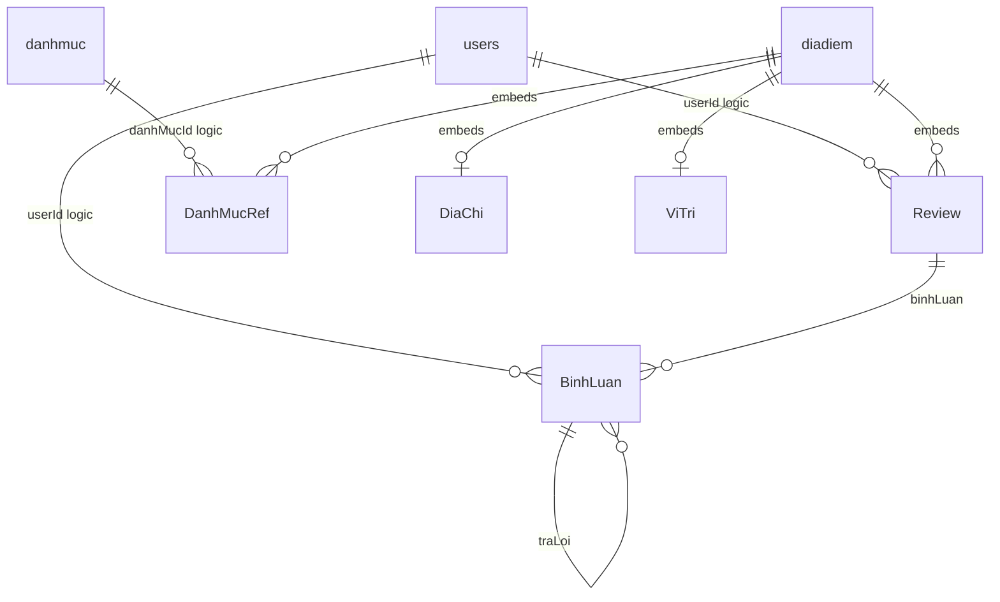

> **Snapshot trước tích hợp.** Hiện trạng mới, thay đổi và cách chạy: [06-INTEGRATION-IMPLEMENTATION.md](06-INTEGRATION-IMPLEMENTATION.md). Các vấn đề/số đếm/liên kết source dưới đây phản ánh thời điểm khảo sát trước khi sửa.

# 01 — Database

## Phạm vi và trạng thái

IMPLEMENTED theo Java models, repositories, services và database scripts; **UNKNOWN runtime**: chưa kết nối DB, không xác minh document, BSON type thực tế, index hay phiên bản MongoDB đang chạy. Database cấu hình `review_diadiem`, local cổng 27017; không có credential trong URI cấu hình hiện hành. `spring.data.mongodb.auto-index-creation=false` tại `backend/src/main/resources/application.properties`.

Ba collection được `@Document` khai báo: `users`, `danhmuc`, `diadiem`. Năm kiểu nhúng: `DiaChi`, `ViTri`, `DanhMucRef`, `Review`, `BinhLuan`. Không có collection riêng cho review/comment hoặc bảng SQL. Không tìm thấy migration có version, JSON Schema validator, Flyway/Liquibase, TTL, DBRef hoặc khóa ngoại cưỡng chế.

## Mô hình và quan hệ

Cardinality ở ERD mô tả khả năng biểu diễn của model, không khẳng định validator runtime ép min/max. `@Id String id` ánh xạ `_id`; các `reviewId/commentId` chỉ là field trong embedded document, tạo bằng UUID ở service. Seed Node dùng ObjectId cho root IDs và reference, trong khi Java dùng String; cần kiểm tra chuyển đổi kiểu ở query/aggregation thực tế. Reference embedded không có DB FK; snapshot `ten/slug`, `tenUser/avatarUser` không được đồng bộ tự động.

Kế hoạch `docs/PROJECT_PLAN.md` giải thích embed để đọc chi tiết bằng một document; đây là ý đồ thiết kế có tài liệu hỗ trợ. Đổi lại mọi review/comment cùng chia sẻ kích thước và điểm tranh chấp của một `diadiem`. Không có giới hạn tổng dung lượng/comment trong service. Không khẳng định khả năng chịu tải khi chưa đo.

## Required, default và enum

Các model không có annotation validation/unique/index; trừ `ViTri.type="Point"`, field object/wrapper mặc định Java là null. Không ghi comment enum hoặc giới hạn array như DB constraint.

| Dữ liệu | Quy tắc có trong code | Giới hạn thực thi |
|---|---|---|
| User mới | AuthService.register đặt role USER, trangThai ACTIVE, hash BCrypt, timestamps | DTO đăng ký kích hoạt validation; unique phụ thuộc script index và race |
| Danh mục mới | thuTu=0, trangThai=ACTIVE khi không truyền; slug từ tên | DanhMucRequest ten 2–80, moTa ≤500 nhưng controller không kích hoạt body validation |
| Địa điểm mới | ratingAvg=0, reviewCount=0, reviews=[]; ACTIVE mặc định | DTO ten 2–150, danhMucId 1–3, moTa 20–2000, ảnh 1–8; chưa kích hoạt validation; create/update lỗi kiểu danh mục |
| Vị trí | Point, coordinates theo model `[lng,lat]` | DTO tọa độ đúng 2 phần tử, không có range; thiếu cascading @Valid |
| Review mới | UUID, ảnh=[] nếu null, binhLuan=[], timestamps, snapshot user | Chặn duplicate user/place và ≥500 reviews ở service; không kiểm 1–5 sao; DTO chưa kích hoạt |
| Bình luận mới | UUID, traLoi=[], timestamps, snapshot placeholder | Depth tối đa 3 trong addReplyRecursive; chưa ép nội dung 1–1000 ở controller |
| Enum | role ADMIN/USER; user ACTIVE/BLOCKED; place/category ACTIVE/HIDDEN; loai AN_UONG/DU_LICH/LUU_TRU là chuỗi/comment | Chỉ toggleStatus admin thực sự whitelist ACTIVE/BLOCKED; không có Java enum/DB enum |

RegisterRequest: username bắt buộc 3–30 ký tự ASCII chữ/số/underscore; hoTen bắt buộc 2–100; email bắt buộc đúng định dạng; password ≥8, có chữ và số. LoginRequest yêu cầu usernameOrEmail và password không rỗng. ReviewRequest: soSao non-null, tieuDe 3–120, noiDung 10–2000, ảnh ≤5; CommentRequest nội dung nonblank 1–1000. `@Size` tự nó không cấm null. DiaChiRequest có duong/quan/thanhPho bắt buộc nhưng parent request thiếu `@Valid`. Xem các file cùng tên ở `backend/src/main/java/com/reviewdiadiem/dto/`.

## Index và seed

| Collection | Index khai báo | Nguồn |
|---|---|---|
| diadiem | slug unique | 01_indexes.js và seed_db.mjs |
| diadiem | text ten, tenKhongDau, moTa, diaChi.quan, diaChi.thanhPho, danhMuc.ten; weights 10/10/2/4/3/6, language none | cả hai script |
| diadiem | viTri 2dsphere | cả hai |
| diadiem | compound loai asc, diaChi.thanhPho asc, ratingAvg desc | cả hai |
| diadiem | trangThai asc, ratingAvg desc, reviewCount desc, partial ACTIVE | cả hai |
| diadiem | danhMuc.danhMucId asc; ngayTao desc | cả hai |
| users | username unique; email unique | chỉ seed_db.mjs |
| danhmuc | slug unique; ten unique | chỉ seed_db.mjs |

Tổng 11 index tường minh ở seed Node, trong đó 7 cho diadiem; không tính `_id` mặc định. `01_indexes.js` chỉ khai báo 7 index địa điểm. Không có index tường minh `reviews.userId`, TTL hoặc unique user/place trong array. Không thể bảo đảm môi trường chỉ chạy script index đã có unique user/email/category.

- `DataSeeder.seed()` là CommandLineRunner: thêm tài khoản mẫu nếu username chưa có, thêm 3 danh mục nếu collection rỗng. Không tạo địa điểm hoặc index. Có credential mẫu hardcoded và log credential; không chép giá trị vào tài liệu.
- `02_seed_data.js` (mongosh): deleteMany ba collection, tạo 5 địa điểm và tính rating bằng JS. Không phải migration an toàn.
- `seed_db.mjs`: deleteMany ba collection, tạo 11 index, hash bằng bcryptjs, chèn 3 users, 3 categories, 13 địa điểm và 32 embedded reviews cùng comments, tính rating bằng JS trước insert. `04_import_data.bat` và `npm run import` gọi seed trước verify.
- `check_db.mjs`: list DB/collection, count, index, sample; `verify_db.mjs`: đọc sample, cây comment, text search, geo, Bayesian top, so rating với review. Các script có console output, chưa có assertion đầy đủ đảm bảo exit khác 0 khi dữ liệu lệch. Chưa chạy.

## CRUD và tính nhất quán

| Luồng | Operations và bằng chứng | Đánh giá |
|---|---|---|
| Register | existsByUsername/email → hash → UserRepository.save (`AuthService.register`) | Check trước save có race; unique chỉ tồn tại khi script phù hợp đã chạy |
| Place create/update | SlugUtil, gán fields, save (`DiaDiemService`) | Không lookup danh mục; snapshot tên/slug null; lỗi DTO/model khiến chưa build được |
| Place delete | existsById → deleteById | Hard delete cả embedded reviews/comments; không có restore/audit |
| Category update/delete | save / deleteById (`DanhMucService`) | Không cập nhật hoặc gỡ snapshot trên địa điểm; không chặn danh mục đang dùng |
| Review create/update/delete | load cả địa điểm → sửa mảng → save → RatingService.recalculate | Có owner check; delete admin hoặc owner; không atomic giữa save và rating |
| Comment CRUD | load địa điểm → tìm review/tree → sửa → save (`CommentService`) | Xóa node loại bỏ cả subtree; không placeholder như frontend; reply có lỗi compile |
| Block user | UserAdminController.toggleStatus save user | Không thu hồi session cũ và service ghi review/comment không kiểm BLOCKED mỗi request |

Không tìm thấy soft-delete flag trong Review/BinhLuan; `trangThai` HIDDEN trên địa điểm/danh mục là trạng thái hiển thị, không phải endpoint restore. Frontend có DELETED nhưng không ánh xạ xuống DB.

`@Transactional` có ở review/comment nhưng không tìm thấy MongoTransactionManager/replica-set config; **UNKNOWN rollback thực tế**, không coi annotation là bằng chứng giao dịch MongoDB. Không có `@Version`, optimistic lock hoặc conditional atomic update chống mất cập nhật; các lần save cả document có thể ghi đè cập nhật đồng thời (rủi ro suy ra từ read-modify-write). Duplicate review check không được DB cưỡng chế.

## Query/aggregation đối chiếu

- `DiaDiemService.list`: ACTIVE, regex q, loai, thành phố, minRating; count + find; sort newest hoặc rating/reviewCount; page 1-based, size cap 50. `danhMuc` được nhận nhưng không dùng. q được đưa trực tiếp vào regex, kết hợp AND hai tên rồi OR hai tên khiến tìm có dấu/không dấu không tương đương mong đợi. Không dùng `$text` nên text index không phục vụ luồng search này.
- List ánh xạ DTO bỏ reviews nhưng query không projection, vẫn fetch embedded tree; `projectionQuery` chỉ là biến không dùng.
- Detail findBySlug không kiểm ACTIVE, trả cả nested reviews/comments.
- Top10: match ACTIVE/reviewCount≥3 → project score `(ratingAvg*reviewCount+17.5)/(reviewCount+5)` → sort → limit10. Không trả score và danh mục trong projection.
- Near: pipeline geoNear → limit → project; code truyền near(lat,lng) khác thứ tự model lng/lat; package/builder NearQuery còn cần compile xác minh. `khoangCachKm` tính nhưng không có trong DTO trả về; `_id` cast String có thể lỗi nếu raw Map chứa ObjectId. Đánh dấu PARTIAL, chưa kiểm đơn vị/kết quả runtime.
- `RatingService.recalculate`: match `_id` → size reviews, avg soSao → làm tròn 2 số → updateFirst rating/count/timestamp. Cần compile/DB test xác minh cú pháp projection và kiểu `_id`; không khẳng định pipeline hiện chạy.
- `DiaDiemRepository.findByReviewsUserId`: projection summary, chưa thấy caller; không có API my-reviews.

## Đối chiếu source → API → UI

Root field dictionary dưới đây được trích trực tiếp từ models. Java String không chứng minh BSON reference là String ở dữ liệu seed; LocalDateTime cần converter Spring khi lưu. Toàn bộ field optional ở mức schema DB chưa thấy validator; required/default ở request/service mô tả phía trên. `passwordHash` chỉ dùng lưu trữ, controller auth/admin chủ động chọn field phản hồi.

Các chênh lệch chính: UI dùng `name/rating/categoryId/status`, API dùng `ten/ratingAvg/danhMucId/trangThai`; UI comment/review là mảng phẳng, DB embed; UI ảnh `{src,name}`, DB array URL; UI không có geo/type `loai`. Bảng đầy đủ ở [04-SYSTEM-INTEGRATION](04-SYSTEM-INTEGRATION.md).

## Phụ lục: dictionary đầy đủ từ Java model

Kiểu ghi ở bảng là kiểu Java khai báo. Root id dùng @Id; còn lại @Field theo tên. Không có FK hoặc validator DB trong các model này. Required/range ở DTO/service đã phân tích ở trên; không áp dụng tự động lên DB. Default “null” là mặc định Java cho field object, không phải default BSON.

### BinhLuan — Bình luận và trả lời nhúng

Nguồn: [backend/src/main/java/com/reviewdiadiem/model/BinhLuan.java](../../backend/src/main/java/com/reviewdiadiem/model/BinhLuan.java).

| Field | Kiểu Java | Required/constraint DB | Default Java | Quan hệ/ý nghĩa |
|---|---|---|---|---|
| commentId | String | Không khai báo validator DB | null | Field lưu trữ |
| userId | String | Không khai báo validator DB | null | Logic reference users._id |
| tenUser | String | Không khai báo validator DB | null | Snapshot tác giả |
| avatarUser | String | Không khai báo validator DB | null | Snapshot tác giả |
| noiDung | String | Không khai báo validator DB | null | Field lưu trữ |
| ngayTao | LocalDateTime | Không khai báo validator DB | null | Timestamp |
| ngayCapNhat | LocalDateTime | Không khai báo validator DB | null | Timestamp |
| traLoi | List<BinhLuan> | Không khai báo validator DB | null | Array; embedded nếu element là model |

### DanhMuc — Danh mục độc lập

Nguồn: [backend/src/main/java/com/reviewdiadiem/model/DanhMuc.java](../../backend/src/main/java/com/reviewdiadiem/model/DanhMuc.java).

| Field | Kiểu Java | Required/constraint DB | Default Java | Quan hệ/ý nghĩa |
|---|---|---|---|---|
| _id (id) | String | @Id; BSON type runtime UNKNOWN | null | Primary document identity |
| ten | String | Không khai báo validator DB | null | Field lưu trữ |
| slug | String | Không khai báo validator DB | null | Field lưu trữ |
| moTa | String | Không khai báo validator DB | null | Field lưu trữ |
| icon | String | Không khai báo validator DB | null | Field lưu trữ |
| thuTu | Integer | Không khai báo validator DB | null | Field lưu trữ |
| trangThai | String | Không khai báo validator DB | null | Field lưu trữ |
| ngayTao | LocalDateTime | Không khai báo validator DB | null | Timestamp |
| ngayCapNhat | LocalDateTime | Không khai báo validator DB | null | Timestamp |

### DanhMucRef — Reference và snapshot danh mục nhúng

Nguồn: [backend/src/main/java/com/reviewdiadiem/model/DanhMucRef.java](../../backend/src/main/java/com/reviewdiadiem/model/DanhMucRef.java).

| Field | Kiểu Java | Required/constraint DB | Default Java | Quan hệ/ý nghĩa |
|---|---|---|---|---|
| danhMucId | String | Không khai báo validator DB | null | Logic reference danhmuc._id |
| ten | String | Không khai báo validator DB | null | Snapshot danh mục |
| slug | String | Không khai báo validator DB | null | Snapshot danh mục |

### DiaChi — Địa chỉ nhúng

Nguồn: [backend/src/main/java/com/reviewdiadiem/model/DiaChi.java](../../backend/src/main/java/com/reviewdiadiem/model/DiaChi.java).

| Field | Kiểu Java | Required/constraint DB | Default Java | Quan hệ/ý nghĩa |
|---|---|---|---|---|
| so | String | Không khai báo validator DB | null | Field lưu trữ |
| duong | String | Không khai báo validator DB | null | Field lưu trữ |
| quan | String | Không khai báo validator DB | null | Field lưu trữ |
| thanhPho | String | Không khai báo validator DB | null | Field lưu trữ |

### DiaDiem — Aggregate root địa điểm

Nguồn: [backend/src/main/java/com/reviewdiadiem/model/DiaDiem.java](../../backend/src/main/java/com/reviewdiadiem/model/DiaDiem.java).

| Field | Kiểu Java | Required/constraint DB | Default Java | Quan hệ/ý nghĩa |
|---|---|---|---|---|
| _id (id) | String | @Id; BSON type runtime UNKNOWN | null | Primary document identity |
| ten | String | Không khai báo validator DB | null | Field lưu trữ |
| slug | String | Không khai báo validator DB | null | Field lưu trữ |
| tenKhongDau | String | Không khai báo validator DB | null | Field lưu trữ |
| loai | String | Không khai báo validator DB | null | Field lưu trữ |
| danhMuc | List<DanhMucRef> | Không khai báo validator DB | null | Array; embedded nếu element là model |
| moTa | String | Không khai báo validator DB | null | Field lưu trữ |
| diaChi | DiaChi | Không khai báo validator DB | null | Embedded object |
| viTri | ViTri | Không khai báo validator DB | null | Embedded object |
| hinhAnh | List<String> | Không khai báo validator DB | null | Array; embedded nếu element là model |
| ratingAvg | Double | Không khai báo validator DB | null | Giá trị tổng hợp từ reviews |
| reviewCount | Integer | Không khai báo validator DB | null | Giá trị tổng hợp từ reviews |
| reviews | List<Review> | Không khai báo validator DB | null | Array; embedded nếu element là model |
| trangThai | String | Không khai báo validator DB | null | Field lưu trữ |
| ngayTao | LocalDateTime | Không khai báo validator DB | null | Timestamp |
| ngayCapNhat | LocalDateTime | Không khai báo validator DB | null | Timestamp |

### Review — Đánh giá nhúng

Nguồn: [backend/src/main/java/com/reviewdiadiem/model/Review.java](../../backend/src/main/java/com/reviewdiadiem/model/Review.java).

| Field | Kiểu Java | Required/constraint DB | Default Java | Quan hệ/ý nghĩa |
|---|---|---|---|---|
| reviewId | String | Không khai báo validator DB | null | Field lưu trữ |
| userId | String | Không khai báo validator DB | null | Logic reference users._id |
| tenUser | String | Không khai báo validator DB | null | Snapshot tác giả |
| avatarUser | String | Không khai báo validator DB | null | Snapshot tác giả |
| soSao | Integer | Không khai báo validator DB | null | Field lưu trữ |
| tieuDe | String | Không khai báo validator DB | null | Field lưu trữ |
| noiDung | String | Không khai báo validator DB | null | Field lưu trữ |
| hinhAnh | List<String> | Không khai báo validator DB | null | Array; embedded nếu element là model |
| ngayTao | LocalDateTime | Không khai báo validator DB | null | Timestamp |
| ngayCapNhat | LocalDateTime | Không khai báo validator DB | null | Timestamp |
| binhLuan | List<BinhLuan> | Không khai báo validator DB | null | Array; embedded nếu element là model |

### User — Tài khoản và trạng thái quyền

Nguồn: [backend/src/main/java/com/reviewdiadiem/model/User.java](../../backend/src/main/java/com/reviewdiadiem/model/User.java).

| Field | Kiểu Java | Required/constraint DB | Default Java | Quan hệ/ý nghĩa |
|---|---|---|---|---|
| _id (id) | String | @Id; BSON type runtime UNKNOWN | null | Primary document identity |
| username | String | Không khai báo validator DB | null | Field lưu trữ |
| hoTen | String | Không khai báo validator DB | null | Field lưu trữ |
| email | String | Không khai báo validator DB | null | Field lưu trữ |
| passwordHash | String | Không khai báo validator DB | null | BCrypt hash, không public |
| avatar | String | Không khai báo validator DB | null | Field lưu trữ |
| role | String | Không khai báo validator DB | null | Field lưu trữ |
| trangThai | String | Không khai báo validator DB | null | Field lưu trữ |
| ngayTao | LocalDateTime | Không khai báo validator DB | null | Timestamp |
| ngayCapNhat | LocalDateTime | Không khai báo validator DB | null | Timestamp |

### ViTri — GeoJSON nhúng

Nguồn: [backend/src/main/java/com/reviewdiadiem/model/ViTri.java](../../backend/src/main/java/com/reviewdiadiem/model/ViTri.java).

| Field | Kiểu Java | Required/constraint DB | Default Java | Quan hệ/ý nghĩa |
|---|---|---|---|---|
| type | String | Không khai báo validator DB | "Point" | Field lưu trữ |
| coordinates | List<Double> | Không khai báo validator DB | null | Array; embedded nếu element là model |
