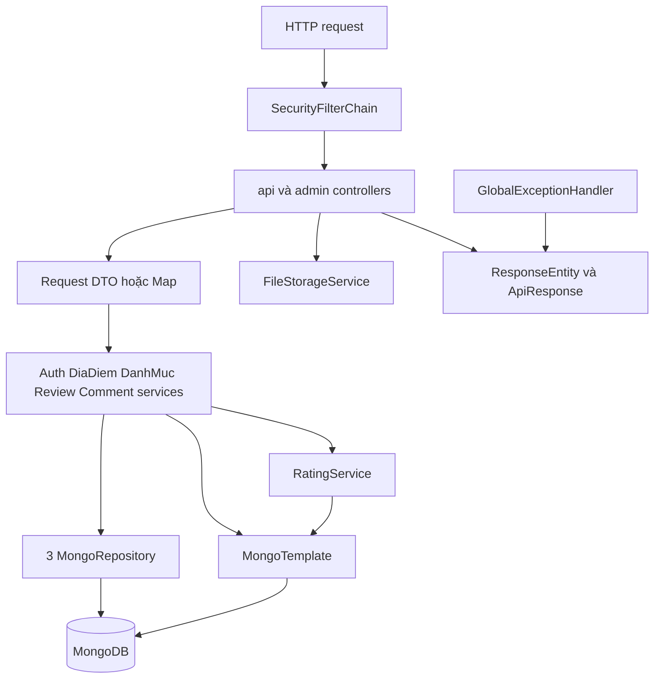
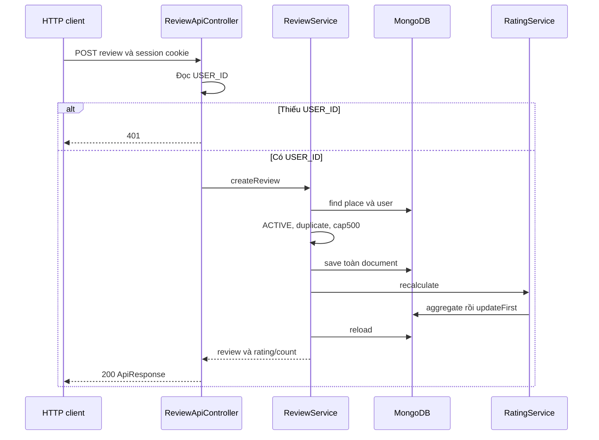

> **Snapshot trước tích hợp.** Hiện trạng mới, thay đổi và cách chạy: [06-INTEGRATION-IMPLEMENTATION.md](06-INTEGRATION-IMPLEMENTATION.md). Các vấn đề/số đếm/liên kết source dưới đây phản ánh thời điểm khảo sát trước khi sửa.

# 02 — Backend

## Kiến trúc và trạng thái

Entry `backend/src/main/java/com/reviewdiadiem/ReviewdiadiemApplication.java`, Spring Boot component scan. Java target 21, Boot 3.2.5, Lombok constructor injection qua `@RequiredArgsConstructor`; `FileStorageService` nhận cấu hình qua `@Value`. Không có interface service/implementation tách riêng. `UserAdminController` truy cập repository trực tiếp.

Trạng thái tổng thể PARTIAL. Source có hai lỗi kiểu rõ ràng: `CommentService.addComment` cast kết quả hàm `getModifiedList` trả `void` thành `List<BinhLuan>`; `DiaDiemService.create/update` truyền `List<DanhMucRefDto>` cho setter yêu cầu `List<DanhMucRef>`. Đây là phát hiện tĩnh, chưa có Maven build log trong phiên này. Binary `backend/target` không chứng minh source hiện tại build thành công.

## Module và dependency

Đếm module nghiệp vụ theo 8 nhóm bên dưới; không coi mỗi package hoặc controller alias là một module riêng.

| Module | Controller → service/function | Repository/model/DTO | Rule và trạng thái |
|---|---|---|---|
| Auth | AuthApiController → AuthService.register/login/logout/me | UserRepository/User; RegisterRequest, LoginRequest | validation auth có kích hoạt; BCrypt; session tùy biến chưa tích hợp Spring Security: PARTIAL |
| Địa điểm và khám phá | DiaDiemApiController, SearchApiController, DiscoverApiController, DiaDiemAdminController → DiaDiemService.list/detail/create/update/delete/top10/near | DiaDiemRepository, MongoTemplate, DiaDiem và nested; SearchRequest, DiaDiemRequest, Summary/Detail | List ACTIVE, create slug check; public write không chặn; compile lỗi danh mục: PARTIAL |
| Danh mục | DanhMucAdminController → DanhMucService.list/create/update/delete | DanhMucRepository/DanhMuc; DanhMucRequest | Admin URL; create duplicate check; không cascade; public list tham chiếu nhưng thiếu: PARTIAL |
| Review | ReviewApiController → ReviewService.createReview/updateReview/deleteReview/listReviews | DiaDiemRepository, UserRepository; Review/ReviewRequest/ReviewDto | USER_ID, owner; delete admin/owner; duplicate và cap500; validation thiếu: PARTIAL |
| Bình luận | CommentApiController → CommentService.addComment/updateComment/deleteComment | DiaDiemRepository, UserRepository được inject nhưng getUser placeholder; BinhLuan/CommentRequest/CommentDto | USER_ID; edit/delete admin/owner; depth3; reply compile lỗi: PARTIAL |
| Rating | Không controller riêng → RatingService.recalculate | MongoTemplate, DiaDiemRepository inject chưa dùng; DiaDiem | Được review gọi sau save, aggregation chưa chạy kiểm chứng: PARTIAL |
| Upload | UploadApiController → FileStorageService.store | local filesystem, MultipartFile, Map url | Authenticated theo filter; giới hạn 5MB; thiếu kiểm kiểu ảnh: PARTIAL |
| Quản lý người dùng | UserAdminController.list/toggleStatus → repository trực tiếp | UserRepository/User; Map body | Admin URL, whitelist ACTIVE/BLOCKED, chưa thu hồi session: PARTIAL |

DTO phản hồi: `ApiResponse<T>{success,data,message,errors}`; thành công thường HTTP 200 (kể cả create), data null cho update/delete; `PageResponse<T>{content,page,size,totalElements,totalPages}`. Detail có `viTri` là array coordinates, không phải GeoJSON object. ReviewDto chứa nested CommentDto; field dictionary ở DB doc. Response admin user loại passwordHash/avatar theo map thủ công.

## Toàn bộ API được khai báo

**32 cặp method/path trong 10 REST controllers.** Đếm alias là endpoint riêng. `/api/auth/logout` còn được LogoutFilter xử lý trên cùng path, không đếm thêm. `/uploads/**` là resource handler, không phải controller API. **Không endpoint nào đang được frontend hiện hành gọi.** Cột UI là màn hình liên quan về nghiệp vụ, không phải bằng chứng integration.

Quy ước: P = filter permitAll theo đường dẫn, S = controller yêu cầu session USER_ID, A = filter hasRole ADMIN, F = filter authenticated. A/F hiện bị khoảng trống SecurityContext; xem phần security. Tất cả row IMPLEMENTED về khai báo và UNKNOWN runtime; thao tác bị lỗi compile/module nêu trên mang PARTIAL.

| Method/path | Controller.function → service.function | Auth/quyền | Request/validation thực thi | Data response; DB; UI liên quan |
|---|---|---|---|---|
| POST /api/auth/register | AuthApiController.register → AuthService.register | P | RegisterRequest @Validated | id,username,hoTen,email,role; users; /register |
| POST /api/auth/login | AuthApiController.login → AuthService.login | P | LoginRequest @Validated, HttpSession | id,username,hoTen,role; users; /login |
| POST /api/auth/logout | AuthApiController.logout → AuthService.logout; có LogoutFilter cùng URL | P | HttpSession | null; invalidate session; Header |
| GET /api/auth/me | AuthApiController.me → AuthService.me | P, tự đọc USER_ID | HttpSession | id,username,hoTen,avatar,role hoặc success=false; users; /profile |
| GET /api/dia-diem | DiaDiemApiController.list → DiaDiemService.list | P | q,loai,thanhPho,danhMuc,minRating,sort,page=1,size=10; không validate SearchRequest | PageResponse Summary; diadiem; /search,/places |
| GET /api/dia-diem/{slug} | DiaDiemApiController.detail → DiaDiemService.detail | P | slug | DiaDiemDetail; diadiem; /places/:id |
| GET /api/dia-diem/top10 | DiaDiemApiController.top10 → DiaDiemService.top10 | P | không | Summary[]; diadiem; /top-10 |
| GET /api/dia-diem/gan-toi | DiaDiemApiController.ganToi → DiaDiemService.near | P | lat,lng bắt buộc; banKinhKm=5,limit=20; thiếu range | Summary[]; diadiem; chưa có UI gần tôi |
| POST /api/dia-diem | DiaDiemApiController.create → DiaDiemService.create | P, thiếu role | DiaDiemRequest, không @Valid body | Summary; diadiem; PlaceFormPage |
| PUT /api/dia-diem/{id} | DiaDiemApiController.update → DiaDiemService.update | P, thiếu role | id, DiaDiemRequest, không @Valid | Summary; diadiem; PlaceFormPage |
| DELETE /api/dia-diem/{id} | DiaDiemApiController.delete → DiaDiemService.delete | P, thiếu role | id | null; diadiem hard-delete; AdminPlacesPage |
| GET /api/search | SearchApiController.search → DiaDiemService.list | F | cùng params list địa điểm | PageResponse Summary; diadiem; SearchPage |
| GET /api/discover/top10 | DiscoverApiController.top10 → DiaDiemService.top10 | F | không | Summary[]; diadiem; TopPlacesPage |
| GET /api/discover/gan-toi | DiscoverApiController.ganToi → DiaDiemService.near | F | lat,lng,banKinhKm=5,limit=20 | Summary[]; diadiem; UI MISSING |
| POST /api/dia-diem/{placeId}/reviews | ReviewApiController.create → ReviewService.createReview | P+S; user tồn tại, place ACTIVE, chưa review | ReviewRequest không @Valid; cap500 service | {review,ratingAvg,reviewCount}; diadiem/users; ReviewFormPage |
| PUT /api/dia-diem/{placeId}/reviews/{reviewId} | ReviewApiController.update → ReviewService.updateReview | P+S, owner | ReviewRequest không @Valid | null; diadiem; ReviewFormPage edit |
| DELETE /api/dia-diem/{placeId}/reviews/{reviewId} | ReviewApiController.delete → ReviewService.deleteReview | P+S, owner hoặc session ROLE ADMIN | path IDs | null; diadiem; ReviewRows |
| GET /api/dia-diem/{placeId}/reviews | ReviewApiController.list → ReviewService.listReviews | P | page=0,size=10,sort=newest; không chặn số âm | {content,page,size,totalElements,totalPages}; diadiem; ReviewRows |
| POST /api/dia-diem/{placeId}/reviews/{reviewId}/comments | CommentApiController.addComment → CommentService.addComment(parent=null) | P+S | CommentRequest không @Valid | {comment}; diadiem; ReviewDetailPage |
| POST /api/dia-diem/{placeId}/reviews/{reviewId}/comments/{commentId}/replies | CommentApiController.addReply → CommentService.addComment(parent=commentId) | P+S, depth≤3 | CommentRequest không @Valid | {comment}; diadiem; CommentThread |
| PUT /api/dia-diem/{placeId}/reviews/{reviewId}/comments/{commentId} | CommentApiController.update → CommentService.updateComment | P+S, owner hoặc session ADMIN | CommentRequest không @Valid | null; diadiem; CommentThread |
| DELETE /api/dia-diem/{placeId}/reviews/{reviewId}/comments/{commentId} | CommentApiController.delete → CommentService.deleteComment | P+S, owner hoặc session ADMIN | path IDs | null; diadiem, xóa subtree; CommentThread |
| POST /api/upload | UploadApiController.upload → FileStorageService.store | F | multipart file; server max5MB, không validate MIME | {url}; local uploads; ImageUpload chỉ đọc local |
| GET /api/admin/danh-muc | DanhMucAdminController.list → DanhMucService.list | A | không | map[] id,ten,slug,moTa,icon,thuTu,trangThai; danhmuc; AdminCategoriesPage |
| POST /api/admin/danh-muc | DanhMucAdminController.create → DanhMucService.create | A | DanhMucRequest không @Valid; check tên/slug service | {id,ten,slug}; danhmuc; CategoryForm |
| PUT /api/admin/danh-muc/{id} | DanhMucAdminController.update → DanhMucService.update | A | DanhMucRequest không @Valid | null; danhmuc; CategoryForm edit |
| DELETE /api/admin/danh-muc/{id} | DanhMucAdminController.delete → DanhMucService.delete | A | id tồn tại | null; danhmuc hard-delete; AdminCategoriesPage |
| POST /api/admin/dia-diem | DiaDiemAdminController.create → DiaDiemService.create | A | DiaDiemRequest không @Valid | Summary; diadiem; PlaceFormPage |
| PUT /api/admin/dia-diem/{id} | DiaDiemAdminController.update → DiaDiemService.update | A | DiaDiemRequest không @Valid | Summary; diadiem; PlaceFormPage edit |
| DELETE /api/admin/dia-diem/{id} | DiaDiemAdminController.delete → DiaDiemService.delete | A | id tồn tại | null; diadiem hard-delete; AdminPlacesPage |
| GET /api/admin/nguoi-dung | UserAdminController.list → UserRepository.findAll | A | không, không phân trang | map[] id,username,hoTen,email,role,trangThai,ngayTao; users; AdminUsersPage |
| PATCH /api/admin/nguoi-dung/{id}/trang-thai | UserAdminController.toggleStatus → UserRepository.findById/save | A | Map trangThai phải ACTIVE/BLOCKED | null; users; UI toggle MISSING |

Nguồn từng row là `backend/src/main/java/com/reviewdiadiem/controller/api/<Controller>.java` hoặc `controller/admin/<Controller>.java`; function và service được nêu ngay trên row. Không có endpoint GET public `/api/danh-muc` dù SecurityConfig cho phép path đó; không có GET admin địa điểm, profile update, my reviews, review toàn cục, statistics, restore/soft-delete theo UI. Không coi API nêu trong kế hoạch là API đã tồn tại.

### Lỗi và HTTP status

Mọi endpoint trả ResponseEntity.ok cho nhánh thành công. Register/category duplicate chủ động trả HTTP200 với success=false. Auth login sai hoặc BLOCKED ném RuntimeException, bị handler tổng quát chuyển 500, không phải 401 theo ý nghĩa nghiệp vụ. Review/comment thiếu USER_ID trả 401 trực tiếp. Không thấy service dùng ApiException cho not-found/ownership, nên đa số lỗi không tìm thấy/không quyền thành 500. User toggle trạng thái sai trả400.

`GlobalExceptionHandler`: ApiException dùng status trong exception; validation/type mismatch→400; DuplicateKey→409; AuthenticationException→401; AccessDeniedException→403; Exception→500 kèm message gốc. Lỗi filter xảy ra trước controller không bảo đảm dùng envelope này; không có custom entry point/access denied handler. Multipart oversized/malformed JSON có thể rơi handler tổng quát; cần runtime test, không khẳng định format/status đã chuẩn.

## Authentication và authorization

- Đăng ký: check username/email → BCrypt strength10 → save user ACTIVE/USER → data map; không tự login.
- Login: lookup username rồi email → BCrypt.matches → chặn BLOCKED → ghi USER_ID/USERNAME/ROLE vào HttpSession. **Không tạo Authentication hoặc lưu SecurityContext**. `SecurityUtil` đọc SecurityContext nhưng chưa thấy caller. Không có UserDetailsService/filter/session bridge tương ứng trong source.
- Vì vậy session nghiệp vụ có thể dùng cho review/comment qua kiểm tra USER_ID, trong khi `hasRole(ADMIN)`/`authenticated()` của filter không nhận login này. Admin login không chứng minh gọi được admin API. Không có `@EnableMethodSecurity`; annotation @PreAuthorize trên class không tự chứng minh được kích hoạt, tuy URL `/api/admin/**` vẫn có filter rule.
- PUBLIC matcher `/api/dia-diem/**` áp dụng mọi HTTP method; CRUD địa điểm không kiểm role/owner ở controller/service. Đây là rủi ro P0 sau khi sửa lỗi build.
- Không thấy JWT, refresh token, OAuth, remember-me, rate limiting hoặc session ID rotation ở login tùy biến. Cookie HttpOnly, Secure=false, SameSite=lax; session IF_REQUIRED; không cấu hình timeout riêng.
- CSRF bị disable dù auth dựa cookie. CORS chỉ hai origin local5173, credentials=true; allowed methods không có PATCH trong khi endpoint khóa user dùng PATCH.
- LogoutFilter và controller cùng `/api/auth/logout`: cần kiểm thứ tự thực tế; chưa xác minh response từ controller có đến được client hay bị filter xử lý trước.
- Account BLOCKED được kiểm lúc login; session đang sống và write service không kiểm lại trạng thái. Ownership review update chỉ owner; delete owner/admin; comment edit/delete owner/admin theo ROLE session.

## Các nghiệp vụ chính

### Tìm kiếm và chi tiết

Actor guest theo `/api/dia-diem`. Input filters/page → controller tạo SearchRequest → service xây Criteria ACTIVE, regex tên, loại/thành phố/minRating → count → skip/limit → find → Summary → envelope. Kết quả rỗng content=[]; page đầu1, size tối đa50 nhưng size≤0 chưa được validation. `danhMuc` bị bỏ qua, q có AND/OR bất thường, regex chưa escape. Detail dùng slug → repository → Detail gồm toàn bộ reviews/comments; không lọc HIDDEN. Lỗi lookup thành500. Bằng chứng `DiaDiemService.list/detail`.

### Gửi/sửa/xóa review và cập nhật điểm

Actor session USER_ID. Create cần địa điểm ACTIVE, chưa có review cùng user, dưới500, user tồn tại. Service snapshot hoTen/avatar, tạo UUID, ghi review vào document; sau save gọi rating aggregation, reload và trả review + tổng điểm/count. Update kiểm owner, gán trường và save rồi recalc; delete kiểm owner hoặc session admin, remove embedded review cùng comments rồi recalc. Không soft-delete, không kiểm khoảng sao. Failures gồm lookup/duplicate/cap/owner; hiện RuntimeException→500. Bằng chứng `ReviewService`, `RatingService`.

Sơ đồ phản ánh thứ tự trong code; không chứng minh runtime/giao dịch đã thành công.

### Bình luận, trả lời và kiểm duyệt

Actor session user; controller đọc USER_ID, ROLE cho update/delete → tìm place/review → tạo UUID và timestamps → add root hoặc recursion parent/depth → save → {comment}. Update/delete recursion kiểm owner/admin; delete loại bỏ node và nhánh con. `getUser` luôn trả tên placeholder/avatar null, chưa lấy UserRepository. Nhánh reply bị chặn bởi lỗi source trả void. Backend không áp dụng yêu cầu giữ phản hồi khi ẩn cha như UI. Bằng chứng `CommentService.addReplyRecursive/updateCommentNode/deleteCommentNode`.

### Quản trị địa điểm/danh mục/người dùng

Actor dự kiến ADMIN qua filter. Place create tạo slug, default rating/count/reviews/status, ánh xạ địa chỉ/geo và save; update thay fields; delete hard-delete. Duplicate slug create ném lỗi, update phụ thuộc unique DB. Category create check tên, suffix thời gian nếu slug trùng; update đổi slug/tên không đồng bộ snapshot; delete không chặn references. User list trả fields chọn lọc, toggle chỉ ACTIVE/BLOCKED rồi save, không revoke session. Các nhánh lỗi theo bảng status phía trên.

### Upload

Actor authenticated theo filter; multipart file → `FileStorageService.store` tạo thư mục `uploads/yyyy/MM`, filename UUID + extension từ tên gốc, Files.copy → `/uploads/yyyy/MM/file`. Giới hạn request/file5MB trong properties; không sniff MIME, whitelist extension, quota, cleanup hoặc chống nội dung chủ động. `WebConfig` phục vụ cố định `file:uploads/`, không theo custom uploadDir nếu đổi cấu hình. UI dùng FileReader nên chưa gọi luồng này.

## Error handling, vận hành và test

Không có request/correlation ID middleware, tracing, timeout/retry riêng hoặc audit trail. Logging application/MongoTemplate DEBUG; RatingService log kết quả, DataSeeder log credential mẫu. Generic error lộ message nội bộ. Không thấy transaction manager; @Transactional chưa bảo đảm Mongo rollback, không có @Version/conditional update. Xem DB doc về race/lost update.

Không có `src/test`, JUnit test thực, integration/E2E backend, CI hoặc coverage report. Maven không có trong PATH; chưa chạy compile/test và không khởi động để tránh DataSeeder ghi DB. TypeScript PASS chỉ áp dụng frontend. Không có external API được service gọi; ngoài MongoDB và local filesystem, dependency runtime khác UNKNOWN.

## Phụ lục DTO và validator khai báo

Nguồn ở thư mục dto; bảng này liệt kê mọi field để đối chiếu hợp đồng. Constraint ở đây là annotation khai báo, hiệu lực controller đã phân biệt phía trên.

| DTO | Fields và kiểu | Constraint annotations |
|---|---|---|
| [ApiResponse](../../backend/src/main/java/com/reviewdiadiem/dto/ApiResponse.java) | success: Boolean; data: T; message: String; errors: Map<String, String> | Không có field constraint |
| [CommentDto](../../backend/src/main/java/com/reviewdiadiem/dto/CommentDto.java) | commentId: String; userId: String; tenUser: String; avatarUser: String; noiDung: String; ngayTao: LocalDateTime; ngayCapNhat: LocalDateTime; traLoi: List<CommentDto> | Không có field constraint |
| [CommentRequest](../../backend/src/main/java/com/reviewdiadiem/dto/CommentRequest.java) | noiDung: String | @NotBlank(message = "Nội dung bình luận không được để trống"); @Size(min = 1, max = 1000) |
| [DanhMucRefDto](../../backend/src/main/java/com/reviewdiadiem/dto/DanhMucRefDto.java) | danhMucId: String; ten: String; slug: String | Không có field constraint |
| [DanhMucRequest](../../backend/src/main/java/com/reviewdiadiem/dto/DanhMucRequest.java) | ten: String; moTa: String; icon: String; thuTu: Integer; trangThai: String | @NotBlank(message = "Tên danh mục không được để trống"); @Size(min = 2, max = 80); @Size(max = 500) |
| [DiaChiRequest](../../backend/src/main/java/com/reviewdiadiem/dto/DiaChiRequest.java) | so: String; duong: String; quan: String; thanhPho: String | @Size(max = 20); @NotBlank(message = "Đường không được để trống"); @Size(max = 150); @NotBlank(message = "Quận/Huyện không được để trống"); @Size(max = 100); @NotBlank(message = "Thành phố không được để trống") |
| [DiaChiSummary](../../backend/src/main/java/com/reviewdiadiem/dto/DiaChiSummary.java) | so: String; duong: String; quan: String; thanhPho: String | Không có field constraint |
| [DiaDiemDetail](../../backend/src/main/java/com/reviewdiadiem/dto/DiaDiemDetail.java) | id: String; ten: String; slug: String; loai: String; danhMuc: List<DanhMucRefDto>; moTa: String; diaChi: DiaChiSummary; viTri: List<Double>; hinhAnh: List<String>; ratingAvg: Double; reviewCount: Integer; reviews: List<ReviewDto>; trangThai: String | Không có field constraint |
| [DiaDiemRequest](../../backend/src/main/java/com/reviewdiadiem/dto/DiaDiemRequest.java) | ten: String; loai: String; danhMucId: List<String>; moTa: String; diaChi: DiaChiRequest; viTri: ViTriRequest; hinhAnh: List<String>; trangThai: String | @NotBlank(message = "Tên địa điểm không được để trống"); @Size(min = 2, max = 150); @NotNull(message = "Loại không được để trống"); @NotNull(message = "Danh mục không được để trống"); @Size(min = 1, max = 3); @NotBlank(message = "Mô tả không được để trống"); @Size(min = 20, max = 2000); @NotNull(message = "Vị trí không được để trống"); @Size(min = 1, max = 8) |
| [DiaDiemSummary](../../backend/src/main/java/com/reviewdiadiem/dto/DiaDiemSummary.java) | id: String; ten: String; slug: String; loai: String; danhMuc: List<DanhMucRefDto>; diaChi: DiaChiSummary; ratingAvg: Double; reviewCount: Integer; hinhAnh: List<String>; trangThai: String | Không có field constraint |
| [LoginRequest](../../backend/src/main/java/com/reviewdiadiem/dto/LoginRequest.java) | usernameOrEmail: String; password: String | @NotBlank(message = "Tên đăng nhập hoặc email không được để trống"); @NotBlank(message = "Mật khẩu không được để trống") |
| [PageResponse](../../backend/src/main/java/com/reviewdiadiem/dto/PageResponse.java) | content: List<T>; page: Integer; size: Integer; totalElements: Long; totalPages: Integer | Không có field constraint |
| [RegisterRequest](../../backend/src/main/java/com/reviewdiadiem/dto/RegisterRequest.java) | username: String; hoTen: String; email: String; password: String | @NotBlank(message = "Tên đăng nhập không được để trống"); @Size(min = 3, max = 30, message = "Tên đăng nhập 3–30 ký tự"); @Pattern(regexp = "^[a-zA-Z0-9_]+$", message = "Chỉ cho chữ cái, số và gạch dưới"); @NotBlank(message = "Họ tên không được để trống"); @Size(min = 2, max = 100); @NotBlank(message = "Email không được để trống"); @Email(message = "Email không đúng định dạng"); @NotBlank(message = "Mật khẩu không được để trống"); @Size(min = 8, message = "Mật khẩu ít nhất 8 ký tự"); @Pattern(regexp = "^(?=.*[a-zA-Z])(?=.*\\d).+$", message = "Mật khẩu phải có chữ và số") |
| [ReviewDto](../../backend/src/main/java/com/reviewdiadiem/dto/ReviewDto.java) | reviewId: String; userId: String; tenUser: String; avatarUser: String; soSao: Integer; tieuDe: String; noiDung: String; hinhAnh: List<String>; ngayTao: LocalDateTime; ngayCapNhat: LocalDateTime; binhLuan: List<CommentDto> | Không có field constraint |
| [ReviewRequest](../../backend/src/main/java/com/reviewdiadiem/dto/ReviewRequest.java) | soSao: Integer; tieuDe: String; noiDung: String; hinhAnh: List<String> | @NotNull(message = "Số sao không được để trống"); @NotBlank(message = "Tiêu đề không được để trống"); @Size(min = 3, max = 120); @NotBlank(message = "Nội dung không được để trống"); @Size(min = 10, max = 2000); @Size(max = 5) |
| [SearchRequest](../../backend/src/main/java/com/reviewdiadiem/dto/SearchRequest.java) | q: String; loai: String; thanhPho: String; danhMuc: String; minRating: Double; sort: String; page: Integer; size: Integer | @NotNull; @Min(1) |
| [ViTriRequest](../../backend/src/main/java/com/reviewdiadiem/dto/ViTriRequest.java) | coordinates: List<Double> | @NotNull(message = "Tọa độ không được để trống"); @Size(min = 2, max = 2) |
