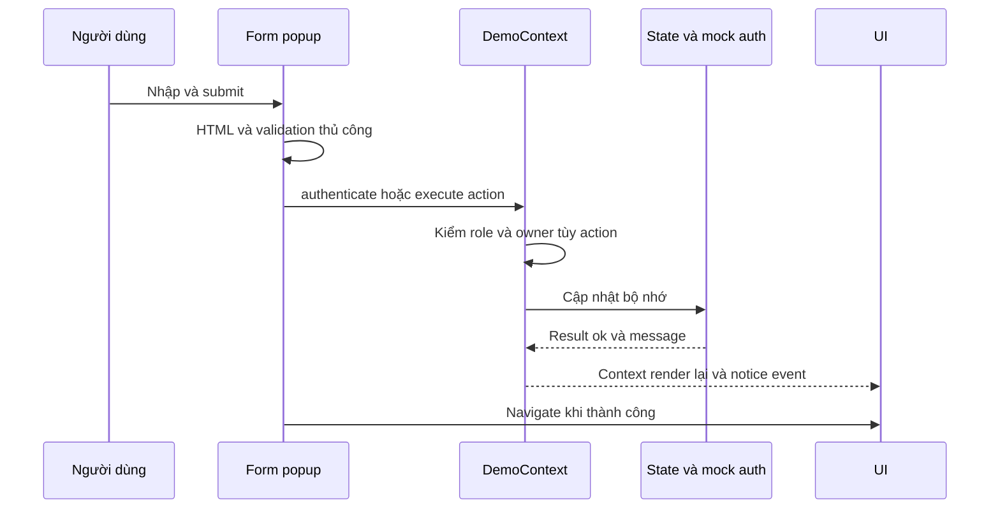

> **Snapshot trước tích hợp.** Hiện trạng mới, thay đổi và cách chạy: [06-INTEGRATION-IMPLEMENTATION.md](06-INTEGRATION-IMPLEMENTATION.md). Các vấn đề/số đếm/liên kết source dưới đây phản ánh thời điểm khảo sát trước khi sửa.

# 03 — Frontend

## Tổng quan

`traveltaste-frontend/index.html` → `src/main.tsx` → createBrowserRouter wildcard → PopupProvider → DemoProvider → App. React StrictMode; TS strict/noEmit/allowJs=false; Vite React và Tailwind plugins. UI dùng Inter, CSS tokens và utility classes. Không có Axios, fetch adapter, request/response interceptor, Redux, React Query hoặc thư viện form riêng trong source hiện hành. Trạng thái bằng React Context/useState/ref; validation HTML và hàm thủ công.

Source `src` gồm 53 TSX, 8 TS (gồm vite-env.d.ts), 2 CSS; 25 page/form components. App khai báo **30 route pattern cụ thể và 1 wildcard fallback**, trong đó 10 popup routes. Tham số động không đếm thành nhiều màn hình. Mọi API call trong bảng dưới đều **không có**; dữ liệu đến từ useDemo hoặc fixtures. IMPLEMENTED về UI mô phỏng, PARTIAL khi đánh giá sản phẩm tích hợp; chỉ typecheck được VERIFIED mới trong phiên khảo sát.

## Routes và màn hình

Quy ước layout P=PublicLayout, S=SimpleLayout bọc PublicLayout, D=PopupShell đặt trên background route, O=layout preview riêng. Vai trò U=USER hoặc ADMIN qua PreviewGate/PopupGate, A=ADMIN qua gate; đây là **vai trò tự chọn**, không phải xác thực server.

| Route | Page/form | Layout/quyền | Mục đích, dữ liệu, action thực tế |
|---|---|---|---|
| / | HomePage | P/guest | Hero, form q chuyển /search, 3 activePlaces, link top10/card |
| /search | SearchPage | P/guest | Search/filter/sort activePlaces, URLSearchParams, tải thêm6 |
| /places | SearchPage | P/guest | Alias danh sách cùng search |
| /places/:id | PlaceDetailPage | P/guest | Lookup ID local, ảnh/mô tả/địa chỉ, distribution, review, tải thêm6, gợi ý, mở review form |
| /categories | CategoriesPage | S/guest | Danh mục ACTIVE, count địa điểm, link /places?category=tên |
| /top-10 | TopPlacesPage | P/guest | rankPlaces theo rating hoặc count, top3 + danh sách4–10 |
| /profile | ProfilePage | S/U | actor, avatar/bio/email, count review, mở chỉnh sửa |
| /my-reviews | MyReviewsPage | S/U | Review actor, lọc ngày/sao/status, pagination6, mở sửa/xóa mềm |
| /reviews | CommunityReviewsPage | S/guest | Review ACTIVE của activePlaces, lọc địa điểm, pagination6 |
| /reviews/:id | ReviewDetailPage | S/guest | Review ACTIVE, ảnh, author, CommentThread; form bình luận cho role khác GUEST |
| /admin | DashboardPage | S/A | Counts, rank local, link quản trị |
| /admin/places | AdminPlacesPage | S/A | Table search/status, pagination6, create/edit, confirm xóa mềm/restore |
| /admin/categories | AdminCategoriesPage | S/A | RowCard theo status, thêm/sửa tên, confirm xóa mềm khi không còn place ACTIVE |
| /admin/reviews | AdminReviewsPage | S/A | Lọc status/sao, pagination6, xem/xóa mềm qua ReviewRows |
| /admin/comments | AdminCommentsPage | S/A | Select review/cấp, CommentThread, ẩn nội dung; default review ID hardcoded |
| /admin/users | AdminUsersPage | S/A | Lọc tên/email/role, pagination6, popup chỉ đọc; chưa khóa tài khoản |
| /admin/statistics | StatisticsPage | S/A | Lọc ngày, aggregateReviews, distribution/top theo local data |
| /status/:code | SystemPage | S/guest | 403/404/500 minh họa, về home; 500 reload |
| /design-system | DesignSystemPage | O/guest | Tokens, typography, Button, FilterChip toggle, link preview |
| /components | ComponentPreviewPage | O/guest | Fixture cards/hero/search/nav, chọn card chỉ set notice, không mở detail |
| /login | AuthPage | D/guest | Input identity/password, busy, loginMock rồi navigate role |
| /register | AuthPage register | D/guest | Tên/email/password/confirmation, registerMock, notice; không có username field riêng |
| /profile/edit | ProfileForm | D/U | name/bio/avatar, PROFILE action, navigate profile |
| /reviews/new | ReviewFormPage | D/U | Place selector, sao, title/content/images, SAVE_REVIEW |
| /reviews/:id/edit | ReviewFormPage edit | D/U+owner | Kiểm ACTIVE/owner, sửa review; place selector disabled |
| /admin/places/new | PlaceFormPage | D/A | name, categoryId, description, address, city, image; SAVE_PLACE |
| /admin/places/:id/edit | PlaceFormPage edit | D/A | Lookup place, sửa local fields |
| /admin/categories/new | CategoryForm | D/A | name, SAVE_CATEGORY |
| /admin/categories/:id/edit | CategoryForm edit | D/A | Lookup ACTIVE, đổi tên và cập nhật snapshot local |
| /admin/users/:id | UserPopup | D/A | Lookup user, avatar/name/email/role/joined/bio, chỉ đọc |
| * | SystemPage code404 | S/guest | Fallback route, không phải HTTP404 được xác minh |

Nguồn route `src/App.tsx`; logic popup `src/routes/popupRoutes.ts`; mỗi component trong `src/pages/` hoặc `src/pages/user/`, `src/pages/admin/` theo tên. PublicLayout cung cấp Header/Footer/PreviewNote; SimpleLayout thêm h1. App dùng backgroundLocation cho popup, link capture, close qua history hoặc fallback; có xử lý document.title/hash/scroll. Các quyền được guard ở App/PreviewGate và kiểm thêm khi execute action.

## Loading, empty, error và responsive

| Nhóm màn hình | Loading/empty/error có bằng chứng | Responsive |
|---|---|---|
| Search/Top | ?state=loading/empty/error để mô phỏng; retry chỉ xóa param; empty khi mảng rỗng | Grid tablet/desktop; top3 và list co giãn |
| Auth | busy disable và notice từ mock; HTML required/email/minLength; lỗi confirmation | Popup full viewport mobile, dialog có max-width trên tablet |
| Place detail | Lookup không thấy → nội dung not-found; ReviewRows có empty; không HTTP loading | 2 cột tablet, ảnh theo breakpoint, cards3 cột |
| Profile/review forms | Missing/DELETED/owner thông báo; form notice; thiếu activePlaces chặn review; ảnh busy/error | Field grid ở form địa điểm; dialog scroll |
| Admin lists/community/my reviews | Lọc rỗng qua EmptyState/ReviewRows; categories có thể chỉ không render rows; StatusPanel mô phỏng state | RowCard xếp dọc/mobile, table overflow-x-auto và ẩn cột tablet, pagination |
| Dashboard/statistics | Stats đồng bộ; top rỗng có EmptyState; StatusPanel mô phỏng | Cards tablet2/desktop4; progress co giãn |
| User popup/system/preview | Lookup không thấy alert; system codes hiển thị tĩnh; preview notice | flex-wrap, max-width, responsive classes |

Không phải mọi màn hình đều có state tải/lỗi riêng; không gán loading từ server cho dữ liệu đồng bộ. `styles/global.css`: min-width320px, tablet40rem, desktop56.25rem; focus-visible và prefers-reduced-motion. Chưa chạy lại viewport/browser QA trong phiên này; artifact cũ không chứng minh mọi breakpoint mới.

## Component inventory và tái sử dụng

| Nhóm | Components/source | Vai trò |
|---|---|---|
| Layout/nav | layout/PublicLayout, Header, PreviewGate | Khung công khai, menu mobile, chọn role, gate preview |
| Popup/form context | common/PopupContext, ConfirmDialog | Modal, dirty draft, useBlocker, beforeunload, focus trap, Escape/backdrop, scroll lock, restore focus |
| Controls | common/Controls | Button/Input/Select/Textarea/Badge/Pagination |
| Workspace | common/WorkspaceUI | Field, WirePanel(details), StatusPanel, EmptyState, StatusBadge, RowCard, Pagination, WorkspaceNavigation |
| Preview primitives | common/Button, FilterChip, Rating, SearchForm, PublicSearch | Button/Link, chip toggle, search nhập từ UI |
| Place hiện hành | place/DestinationCard | Link ID thật trong local data, ảnh lazy, rating/count |
| Place preview/legacy | places/HeroImage, PlaceCard, PlaceGrid, PlaceSection, PlaceFilters | Bộ preview F1 và các component còn từ bố cục trước |
| Review/comment | reviews/ReviewRows, StarInput, CommentThread | Listing/action, radio1–5 sao, cây3 cấp từ mảng phẳng |
| Upload | common/ImageUpload | FileReader data URL, preview/xóa ảnh; max mặc định3, nơi profile/place max1 |
| Feedback | feedback/Toast, AsyncState | Notice qua CustomEvent, tự ẩn5s; Skeleton/Empty/Error |
| Admin phụ | layout/AdminPanels | details panel; chưa thấy được import trong app |

Tồn tại nhiều bộ Button, Pagination, EmptyState và field styles giữa Controls/WorkspaceUI/primitives. Đây là trùng trách nhiệm, chưa phải chứng minh lỗi. `PlaceSection`, `PlaceFilters`, `AdminPanels` không có import từ các source khác trong kiểm kê tĩnh; không xóa vì phạm vi chỉ tài liệu. `Controls.Textarea` chưa thấy consumer trực tiếp. PlaceCard/PlaceGrid vẫn được ComponentPreviewPage dùng, không coi toàn bộ thư mục places là dead code.

## State, authentication và form flow

`createDemoData()` tạo 3 user, 2 category, 12 place; 52 review từ công thức fixture (3×12 + 7×2 + 2×1) và 3 comment. Đây là số lượng **mẫu từ source**, không phải số document DB hay số người dùng thật. Review fixtures cố ý lặp user trên cùng place, khác backend rule một review/user/place. TODAY hardcoded 2026-10-20 cho action mới; đăng ký dùng ngày thực ISO. Ảnh gồm assets local và placeholder.

`DemoProvider` lưu data bằng useState; dataRef tránh stale snapshot khi execute liên tiếp. sessionStorage chỉ lưu `traveltaste-preview-role` và `traveltaste-session-user`; dữ liệu sửa và credentials Map không lưu bền. Reload khôi phục fixture và xóa user mới khỏi data; effect reset GUEST nếu session user không còn. setRole tự xóa session user, actor fallback sang ID user/admin mẫu. Không có token storage, refresh token, cookie HTTP integration hay interceptor.

`services/mock/auth.ts`: delay250ms, identity lookup theo email (UI label có username nhưng mock không lookup username), plaintext credential Map trong bộ nhớ, register kiểm tên/email/password≥8/duplicate email rồi tạo USER. Đây là mô phỏng có chủ đích, không nên đánh giá là password storage production. Auth form xác nhận password, busy disable, success navigate profile/admin; logout chọn GUEST và về home.

Các action trong `DemoContext.perform`:

- PROFILE: non-guest, name không trống; map actor, cập nhật name/bio/avatar.
- SAVE_REVIEW: USER hoặc ADMIN; place ACTIVE; title/content nonblank, sao1–5; edit ACTIVE/owner; không chặn duplicate hoặc cap500. DELETE_REVIEW: owner/admin, status DELETED, giữ record.
- ADD_COMMENT: non-guest, review ACTIVE, nội dung trim không trống, parent cùng review và depth<3. EDIT_COMMENT owner, 1–2000 ký tự; DELETE_COMMENT owner/admin, DELETED và giữ replies. Thêm comment không tự giới hạn2000 khi gọi execute trực tiếp; HTML textarea có maxLength.
- SAVE_PLACE: ADMIN, name/city/address/image và category ACTIVE; tạo/sửa local, status ACTIVE. PLACE_STATUS: ADMIN, restore chỉ khi category ACTIVE.
- SAVE_CATEGORY: ADMIN, name nonblank và unique không phân biệt hoa thường; cập nhật tên snapshot trên place. DELETE_CATEGORY: ADMIN, chặn khi còn place ACTIVE, đổi DELETED.
- execute dispatch `traveltaste:notice`; reset xác nhận rồi khôi phục fixtures/credentials/role. ConfirmDialog hỗ trợ thao tác xóa, PopupShell bảo vệ draft.

Form Review title max200/content max5000, category name max100, place name max200/description max5000; khác DTO backend. FileReader kiểm PNG/JPEG/WebP ≤5MB mỗi ảnh, max3 review/max1 place-avatar; không POST multipart. Popup có chọn ảnh/preview không chứng minh file đã lên server.

## UI–API mapping hiện tại

| Screen/action | Frontend function/action | API tương ứng có trong backend | Backend handler/database | Status |
|---|---|---|---|---|
| Auth submit | AuthPage.submit → authenticate/registerMock | POST /api/auth/login, /register | AuthService/users | PARTIAL: không gọi; register thiếu username/hoTen mapping |
| Logout/profile read | Header/logout; ProfilePage useDemo | POST /api/auth/logout; GET /api/auth/me | AuthService/users | PARTIAL: local only |
| Profile save | ProfileForm → PROFILE | Không có update profile | MISSING; User thiếu bio | MISSING integration |
| Search/filter/detail | SearchPage local filter; PlaceDetail lookup | GET /api/dia-diem; GET /api/dia-diem/{slug} | DiaDiemService/diadiem | PARTIAL: ID/slug và filters khác |
| Top10 | rankPlaces | GET /api/dia-diem/top10 | DiaDiemService.top10/diadiem | PARTIAL: công thức khác |
| Category browse | CategoriesPage data | Không có GET /api/danh-muc | handler MISSING | MISSING integration |
| Review create/edit/delete | SAVE_REVIEW, DELETE_REVIEW | POST/PUT/DELETE /api/dia-diem/{placeId}/reviews... | ReviewService/diadiem | PARTIAL: soft-delete vs hard-delete |
| Comment CRUD/reply | ADD_COMMENT, EDIT_COMMENT, DELETE_COMMENT | nested comments endpoints | CommentService/diadiem | PARTIAL: schema/delete và lỗi reply |
| Place admin save/delete/restore | SAVE_PLACE, PLACE_STATUS | admin POST/PUT/DELETE địa điểm; restore riêng thiếu | DiaDiemService/diadiem | PARTIAL: local fields/status |
| Category admin | SAVE_CATEGORY, DELETE_CATEGORY | admin CRUD danh mục | DanhMucService/danhmuc | PARTIAL: local cascade guard khác |
| User list/detail | data.users, UserPopup | GET /api/admin/nguoi-dung; detail riêng không có | UserAdminController/users | PARTIAL: only read local; khóa user UI thiếu |
| Dashboard/statistics/my/community | selectors/aggregateReviews | aggregate toàn cục/my-review API không có | MISSING; một repository method chưa expose | MISSING integration |
| File choose | ImageUpload.select | POST /api/upload | FileStorageService/local | PARTIAL: data URL only |
| Component preview card click | onSelect setNotice | Không gọi | Không có DB | IMPLEMENTED preview; không phải chuyển detail |

Không tìm thấy lời gọi frontend sai URL vì không có HTTP call nào. Không phát hiện nút nghiệp vụ hoàn toàn trống trong các forms chính đã đọc; có callback `onNotice={() => {}}` ở PlaceDetailPage nhưng ReviewRows ở đó không bật manage. Không kết luận nút hoạt động E2E từ onClick. API backend đều chưa được UI sử dụng; ngược lại profile update/statistics/restore là hành vi local chưa có backend tương đương.

## Testing

VERIFIED mới: `npm run typecheck` exit0 ngày20/10/2026. Có 5 scripts Playwright/compatibility trong `scripts/`; verify-f2 và verify-f3-f4 chuyển tiếp verify-popups. Kiểm thử UI dùng role sessionStorage, thao tác mock, geometry, ảnh, focus, dialog, dirty draft, filter, CRUD local; không truy cập MongoDB. Báo cáo lịch sử passed và failure cùng tồn tại (README tổng ghi chi tiết). Chưa chạy lại production build, browser suite, network failure, backend integration hoặc coverage. Không sửa/rewrite screenshots lịch sử.
