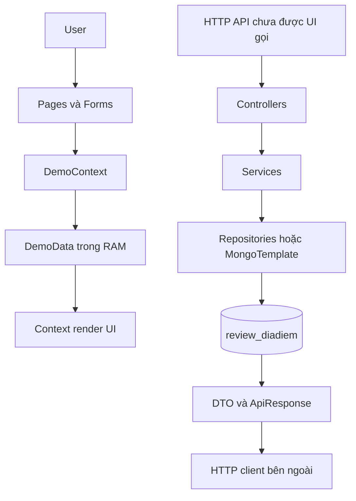
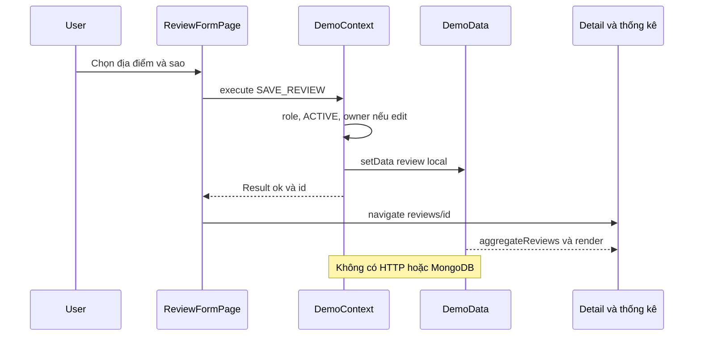
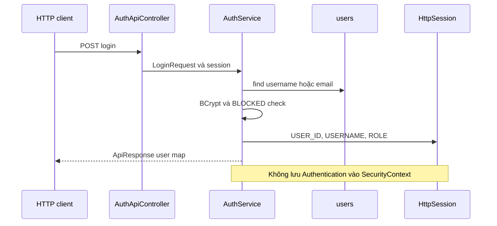

> **Snapshot trước tích hợp.** Hiện trạng mới, thay đổi và cách chạy: [06-INTEGRATION-IMPLEMENTATION.md](06-INTEGRATION-IMPLEMENTATION.md). Các vấn đề/số đếm/liên kết source dưới đây phản ánh thời điểm khảo sát trước khi sửa.

# 04 — Tích hợp hệ thống

## Kết luận về đường đi thực tế

Chuỗi `User → Frontend → API → Controller → Service → Repository → Database → Response → UI` **chưa được nối**. Chuỗi UI kết thúc ở state local; chuỗi API chỉ có source, còn lỗi compile và chưa runtime test. Có thể xác định **14 nhóm luồng cần đối chiếu xuyên tầng**, nhưng **0 luồng được VERIFIED end-to-end với MongoDB**. Không lấy UI Playwright mock làm bằng chứng backend.

Nguồn: frontend `src/main.tsx`, `App.tsx`, `state/DemoContext.tsx`, `services/mock/auth.ts`; backend `controller/`, `service/`, `repository/`; `vite.config.js` không có proxy. Phân tích source không thấy fetch/axios/XMLHttpRequest/WebSocket trong frontend.

## Feature Traceability Matrix

Tests ở bảng là kiểm tra mới hoặc artifact lịch sử, không tự khẳng định PASS mới. Mọi API trong cột API đều chưa được UI gọi. Status áp dụng mức tích hợp.

| Feature | Frontend | API | Service | Database | Tests | E2E | Status |
|---|---|---|---|---|---|---|---|
| 1. Đăng ký/đăng nhập/logout/me | AuthPage, mock auth, Header | 4 auth endpoints | AuthService | users | Typecheck mới; UI auth lịch sử | UNKNOWN | PARTIAL: session security bridge thiếu |
| 2. Tìm kiếm/lọc địa điểm | SearchPage, local params | GET dia-diem/search | DiaDiemService.list | diadiem | UI filter lịch sử; DB script chưa chạy | UNKNOWN | PARTIAL: regex và category lỗi |
| 3. Xem chi tiết | PlaceDetailPage, ReviewRows | GET dia-diem/{slug}, GET reviews | detail/listReviews | diadiem embedded | UI detail lịch sử | UNKNOWN | PARTIAL: ID/slug, HIDDEN |
| 4. Xếp hạng Top10 | TopPlacesPage, rankPlaces | 2 alias top10 | top10 aggregation | diadiem rating/count | UI ranking lịch sử; DB script chưa chạy | UNKNOWN | PARTIAL: ranking khác công thức |
| 5. Gần tôi | MISSING page/action | 2 alias gan-toi | near | viTri 2dsphere | DB script khác pipeline API, chưa chạy | UNKNOWN | PARTIAL |
| 6. Duyệt danh mục | CategoriesPage | public list MISSING | admin list có | danhmuc + snapshot | UI lịch sử | UNKNOWN | MISSING integration |
| 7. Quản lý địa điểm | AdminPlacesPage, PlaceForm | public/admin write | create/update/delete | diadiem | UI local CRUD lịch sử | UNKNOWN | PARTIAL: compile/security/delete |
| 8. Quản lý danh mục | AdminCategoriesPage, CategoryForm | admin CRUD | DanhMucService | danhmuc | UI local CRUD lịch sử | UNKNOWN | PARTIAL: cascade/status khác |
| 9. Đăng/sửa/xóa review và rating | ReviewForm, ReviewRows, aggregateReviews | nested review CRUD | ReviewService + RatingService | diadiem.reviews | UI local lịch sử; backend tests MISSING | UNKNOWN | PARTIAL: validation/race/delete |
| 10. Bình luận/trả lời/kiểm duyệt | ReviewDetail, CommentThread, AdminComments | nested comments CRUD/replies | CommentService | reviews.binhLuan.traLoi | UI3 cấp lịch sử | UNKNOWN | PARTIAL: reply compile, snapshot |
| 11. Hồ sơ | ProfilePage/ProfileForm | me read; update MISSING | AuthService.me | users, bio MISSING | UI save local lịch sử | UNKNOWN | PARTIAL |
| 12. Quản lý user | AdminUsersPage/UserPopup read-only | list/PATCH trang-thai | controller→UserRepository | users | UI read-only lịch sử | UNKNOWN | PARTIAL: khóa UI thiếu/CORS |
| 13. My reviews/community/dashboard/statistics | nhiều page + selectors | global/my/statistics APIs MISSING | repository my method chưa expose | embedded review có | UI local thống kê lịch sử | UNKNOWN | MISSING integration |
| 14. Ảnh/upload | ImageUpload FileReader | POST upload | FileStorageService | local file + URL | UI preview lịch sử | UNKNOWN | PARTIAL: server upload chưa nối |

## Đối chiếu hợp đồng field và rule

| Khía cạnh | Frontend (`types/domain.ts`, forms, DemoContext) | Backend/DB | Hệ quả |
|---|---|---|---|
| User | id,name,email,role,bio,avatar,joined | id,username,hoTen,email,passwordHash,avatar,role,trangThai,ngayTao,ngayCapNhat | Adapter/name/date và API bio/update thiếu |
| Register | name,email,password; confirmation ở form | username,hoTen,email,password | Không thể gửi nguyên body local sang API |
| Login | identity email-only mock | usernameOrEmail | UI label username chưa đúng mock; request khác tên |
| Place | name,city,address,description,image,categoryId,rating,status | ten,diaChi object,moTa,hinhAnh[],danhMucId[],loai,viTri,ratingAvg,trangThai | Thiếu tọa độ/loai, đổi cấu trúc địa chỉ và ảnh/danh mục |
| Detail identity | /places/:id lookup local id | /api/dia-diem/{slug} lookup slug | Phải phân biệt slug đọc và id ghi |
| Category | id,name,status | ten,slug,moTa,icon,thuTu,trangThai | UI chỉ sửa tên, không đủ toàn DTO |
| Review | id,placeId,userId,title,content,stars,images,date,status | embedded reviewId,userId,tieuDe,noiDung,soSao,hinhAnh,ngayTao; parent placeId ở URL | Cần chuyển schema, không có status trong DB |
| Comment | id,reviewId,parentId,userId,content,date,status; mảng phẳng | commentId,userId,noiDung,ngayTao,traLoi[]; lồng trong review | Phải flatten/nest và giữ context IDs |
| Ảnh | {src,name}, data URLs | URL string[], multipart file→{url} | Chưa có bước upload trước ghi record |
| Search | q,category(tên),city,minimum; sort name/rating/reviews | q,danhMuc,thanhPho,minRating,loai; sort newest/rating | danhMuc backend nhận nhưng bỏ qua; sort options khác |
| Pagination | cắt6; state1-based | places1-based size10/cap50; reviews0-based | Cần chuyển page riêng từng API |
| Delete/restore | status DELETED, giữ comment replies; restore place | hard-delete document/review/comment subtree; ACTIVE/HIDDEN cho place/category | UI và backend khác semantics, mất dữ liệu nếu nối thẳng DELETE |
| Ranking/rating | avg1 chữ số; sort rating/count; không threshold | avg2 chữ số; Bayesian top, reviewCount≥3 | Thứ hạng/điểm hiển thị không đồng nhất |
| Review uniqueness | Fixtures/cập nhật cho phép nhiều review một user/place | create chặn một review/user/place; cap500 | Dữ liệu mẫu UI không dùng trực tiếp để nghiệm thu backend |
| Length limits | Review title200/content5000; comment2000; category100 | DTO title120/content2000; comment1000; category80 | UI có thể nhận input backend dự kiến từ chối, validation backend chưa kích hoạt |
| Authorization | tự chọn role, actor fallback; guards local | session USER_ID/ROLE và Spring Security authorities không nối | UI role không có giá trị phân quyền server |
| Result/error | {ok,message,id?}, toast | {success,data,message,errors}, lỗi HTTP không nhất quán | Cần error/result adapter, chưa có interceptor |

## Hai luồng đại diện và điểm ngắt

### Luồng UI review hiện có

### Luồng login backend hiện có

Đường tiếp theo đến admin API vẫn đi qua hasRole ADMIN, nên thuộc tính ROLE đơn thuần không đáp ứng filter. Chưa chạy HTTP để ghi nhận status cụ thể. Chuỗi review backend độc lập được mô tả ở [02-BACKEND](02-BACKEND.md).

## Mức kiểm chứng và điều kiện nghiệm thu tích hợp

VERIFIED giới hạn ở TypeScript compile noEmit. Kết quả UI cũ ở screenshots chứng minh các thao tác mock trong phiên cũ; không có bằng chứng DB write từ UI. Backend chưa compile mới, chưa login/cookie HTTP, chưa kiểm index/text/geo/rating/rollback, chưa đo concurrent update hoặc load test. Không xác minh deployment.

Để nghiệm thu tích hợp trong tương lai: sửa build/security, dùng DB thử nghiệm, adapter DTO/IDs/status rõ ràng, test UI ghi review rồi đọc document/rating qua API, test 401/403/ownership/BLOCKED, negative validation, duplicate/concurrency, upload và xóa/restore phù hợp rule đã thống nhất. Đây là đề xuất kiểm chứng, không tự triển khai hoặc bổ sung business rule trong phiên tài liệu.
