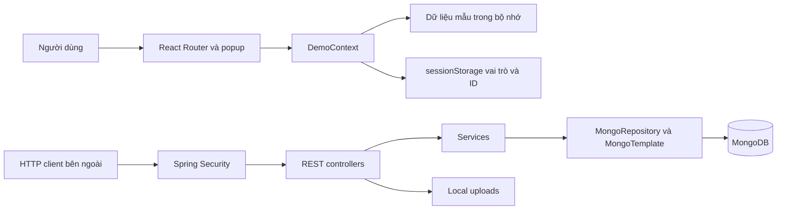

> **Snapshot trước tích hợp.** Hiện trạng mới, thay đổi và cách chạy: [06-INTEGRATION-IMPLEMENTATION.md](06-INTEGRATION-IMPLEMENTATION.md). Các vấn đề/số đếm/liên kết source dưới đây phản ánh thời điểm khảo sát trước khi sửa.

# TravelTaste — kiến trúc và hiện trạng

Ngày khảo sát: 20/10/2026, Asia/Saigon. Phạm vi là các tệp hiện có trong working tree `D:/danhgia/TravelTaste`, branch `main`; không suy diễn từ tệp đã xóa trong Git hoặc binary build cũ.

TravelTaste có backend đánh giá địa điểm bằng Spring Boot/MongoDB và frontend mô phỏng bằng React. **Frontend hiện không gọi backend**. Các thao tác đăng nhập, quản trị, review, bình luận và thống kê trên UI chạy trong bộ nhớ trình duyệt. Backend có các khai báo HTTP và xử lý nghiệp vụ nhưng còn lỗi source ngăn biên dịch và khoảng trống bảo mật. Chưa đủ bằng chứng để kết luận hệ thống hoạt động end-to-end.

## Quy ước bằng chứng

| Nhãn | Ý nghĩa |
|---|---|
| IMPLEMENTED | Có triển khai trong source, chưa mặc định chạy đúng |
| VERIFIED | Có kết quả kiểm tra cụ thể; luôn ghi phạm vi kiểm tra |
| PARTIAL | Có triển khai nhưng thiếu hoặc sai một phần |
| MISSING | Được kế hoạch/UI/cấu hình tham chiếu nhưng chưa có triển khai tương ứng |
| UNKNOWN | Chưa đủ bằng chứng, đặc biệt runtime DB, HTTP và deployment |

Các nhãn có thể áp dụng cho các khía cạnh khác nhau của cùng chức năng. VERIFIED TypeScript không có nghĩa VERIFIED backend hoặc E2E.

## Công nghệ và cấu trúc

| Thành phần | Bằng chứng thực tế |
|---|---|
| Backend | Java target 21; Spring Boot parent 3.2.5; Lombok 1.18.30; Maven; Spring Web, Security, Data MongoDB, Validation, starter-test/security-test — `backend/pom.xml` |
| Frontend | React/React DOM ^19.3.1; Router ^7.18.4; TypeScript ^7.0.2; Vite ^8.3.4; Tailwind ^4.3.3; Playwright ^1.64.1 — `traveltaste-frontend/package.json` |
| Dữ liệu | MongoDB, DB `review_diadiem`, local host cổng 27017; server version UNKNOWN. Kế hoạch ghi 7+ là mục tiêu, không phải phiên bản đã đo |
| DB tools | Node ESM, mongodb ^6.5.0, bcryptjs ^2.4.3 — `database/package.json` |
| UI/state | Tailwind utilities, Inter, React Context/useState; không có Axios/Redux/Leaflet trong dependency hiện hành |
| Runtime kiểm tra | Node v26.8.1 được đọc bằng `node --version`; Maven không tìm thấy trong PATH; phiên bản Java thực chạy UNKNOWN |

Phiên bản có dấu `^` là khoảng phiên bản khai báo, không phải khẳng định dependency cài trên mọi máy. Lockfiles tồn tại ở frontend và database. `HUONG-DAN-CHAY.md`/`docs/PROJECT_PLAN.md` còn mô tả React 18, Axios, Leaflet và thư mục `frontend/`; dùng cấu hình hiện hành làm nguồn ưu tiên.



Không có cạnh React → REST trong sơ đồ vì chưa tìm thấy HTTP adapter trong `traveltaste-frontend/src`.

## Tài liệu

1. [Database: schema, index, consistency](01-DATABASE.md)
2. [Backend: module, toàn bộ endpoint, security, nghiệp vụ](02-BACKEND.md)
3. [Frontend: routes, component, state, hành vi UI](03-FRONTEND.md)
4. [Tích hợp: hợp đồng dữ liệu và feature matrix](04-SYSTEM-INTEGRATION.md)
5. [Khoảng trống và rủi ro có bằng chứng](05-GAPS-AND-RISKS.md)

## Chạy theo cấu hình có thật

Frontend độc lập, từ thư mục gốc:

```powershell
cd traveltaste-frontend
npm ci
npm run typecheck
npm run dev
```

`dev` bind 127.0.0.1, cổng mặc định Vite 5173. UI không cần MongoDB/backend để chạy demo. Không in lại thông tin đăng nhập mẫu trong bộ tài liệu này; xem luồng mô phỏng ở `src/services/mock/auth.ts` nếu cần khảo sát code.

Backend có lệnh Maven sau nhưng **source hiện còn lỗi tĩnh** nêu trong G01; đây là hướng dẫn theo build config, không phải lệnh đã chạy thành công:

```powershell
cd backend
mvn compile
mvn spring-boot:run
```

Backend cấu hình cổng 8080 và kết nối local DB. Khi khởi động, `config/DataSeeder.seed()` có thể tạo tài khoản/danh mục; chỉ thực hiện trên DB thử nghiệm có chủ đích. Phiên khảo sát này không khởi động backend, không seed/import, không thay database. `database/seed_db.mjs`, `02_seed_data.js` xóa dữ liệu trước khi nạp, nên không dùng làm bước kiểm tra không phá hủy. `check_db.mjs`/`verify_db.mjs` là script đọc nhưng có thể in document; chưa chạy trong phiên này.

`vite.config.js` không có proxy `/api` hoặc `/uploads`. Không tìm thấy Dockerfile, compose, workflow CI, reverse proxy hoặc cấu hình production trong phạm vi source. SPA cần cấu hình fallback trên hosting; cấu hình đó UNKNOWN.

## Kết quả kiểm chứng và giới hạn

- VERIFIED: `npm run typecheck` chạy ngày khảo sát, exit 0, `tsc --noEmit`; không phát sinh mã build.
- Có báo cáo Playwright cũ: `traveltaste-frontend/docs/screenshots/redesign/verification.json` ghi passed, 72 checks/9 flows; `popups/all/verification.json` ghi passed, 40 checks/8 flows; `screenshots/verification.json` ghi passed, 6 checks. Đây là bằng chứng lịch sử UI mock, chưa chạy lại và không chứng minh API/DB.
- `redesign/failure.json` cũng còn tồn tại; không bỏ qua artifact thất bại và không suy diễn thứ tự chạy chỉ từ tên tệp.
- Không có `backend/src/test`; dependency test không đồng nghĩa có test. Không đo coverage, tải đồng thời hoặc E2E thật.
- Runtime MongoDB, index đang tồn tại, số document thật, HTTP status thực, rollback, geospatial và backend build UNKNOWN.
- Working tree ban đầu có 5.536 mục tracked bị xóa dưới `frontend/` (gồm dependencies) và `traveltaste-frontend/` untracked. Giữ nguyên; không commit/push/đổi branch.

## Tiến độ

Đã khảo sát source backend, frontend, DB tools, cấu hình, scripts QA và tài liệu hiện có; bỏ qua node_modules, cache, target, dist, ảnh/binary và nội dung sinh tự động không cần thiết. Các phụ lục inventory/schema/API được trích từ source để kiểm tra số lượng và liên kết. Chi tiết số lượng được ghi sau bước xác minh tài liệu.

## Kết quả kiểm kê và định nghĩa số đếm

- **129 tệp source/script**: 53 Java + 63 frontend src (53 TSX, 8 TS, 2 CSS) + 5 script QA + 6 script DB/batch + Vite config và HTML entry. Không tính lockfiles, tài liệu, cấu hình JSON/properties, binary hoặc dependency vào số source. Các cấu hình đó vẫn được khảo sát riêng.
- **8 module nghiệp vụ** theo bảng backend.
- **3 collection root, 8 model gồm 5 embedded types**; không đếm embedded thành collection.
- **32 endpoint HTTP** từ annotation mapping, gồm aliases; không đếm resource handler hoặc endpoint chỉ nêu trong kế hoạch.
- **30 route pattern cụ thể + 1 wildcard**, **25 page/form components**; route auth/form được dùng cho nhiều pattern.
- **14 nhóm luồng xuyên tầng được đối chiếu, 0 E2E được VERIFIED**.
- **22 vấn đề: P0=2/P1=12/P2=6/P3=2**.

### Inventory source đã khảo sát

Danh sách là working tree thực, đọc source và đối chiếu khai báo/import/handler; không bao gồm đường dẫn frontend cũ đã bị xóa. Các source nghiệp vụ đã được đọc; phần fixture lặp lại/QA được kiểm cấu trúc, query/assertion và entrypoint. Không coi số tệp là test coverage.

| Source | Dòng |
|---|---|
| [backend/src/main/java/com/reviewdiadiem/ReviewdiadiemApplication.java](../../backend/src/main/java/com/reviewdiadiem/ReviewdiadiemApplication.java) | 13 |
| [backend/src/main/java/com/reviewdiadiem/config/DataSeeder.java](../../backend/src/main/java/com/reviewdiadiem/config/DataSeeder.java) | 96 |
| [backend/src/main/java/com/reviewdiadiem/config/SecurityConfig.java](../../backend/src/main/java/com/reviewdiadiem/config/SecurityConfig.java) | 78 |
| [backend/src/main/java/com/reviewdiadiem/config/WebConfig.java](../../backend/src/main/java/com/reviewdiadiem/config/WebConfig.java) | 16 |
| [backend/src/main/java/com/reviewdiadiem/controller/admin/DanhMucAdminController.java](../../backend/src/main/java/com/reviewdiadiem/controller/admin/DanhMucAdminController.java) | 39 |
| [backend/src/main/java/com/reviewdiadiem/controller/admin/DiaDiemAdminController.java](../../backend/src/main/java/com/reviewdiadiem/controller/admin/DiaDiemAdminController.java) | 38 |
| [backend/src/main/java/com/reviewdiadiem/controller/admin/UserAdminController.java](../../backend/src/main/java/com/reviewdiadiem/controller/admin/UserAdminController.java) | 54 |
| [backend/src/main/java/com/reviewdiadiem/controller/api/AuthApiController.java](../../backend/src/main/java/com/reviewdiadiem/controller/api/AuthApiController.java) | 41 |
| [backend/src/main/java/com/reviewdiadiem/controller/api/CommentApiController.java](../../backend/src/main/java/com/reviewdiadiem/controller/api/CommentApiController.java) | 74 |
| [backend/src/main/java/com/reviewdiadiem/controller/api/DiaDiemApiController.java](../../backend/src/main/java/com/reviewdiadiem/controller/api/DiaDiemApiController.java) | 94 |
| [backend/src/main/java/com/reviewdiadiem/controller/api/DiscoverApiController.java](../../backend/src/main/java/com/reviewdiadiem/controller/api/DiscoverApiController.java) | 35 |
| [backend/src/main/java/com/reviewdiadiem/controller/api/ReviewApiController.java](../../backend/src/main/java/com/reviewdiadiem/controller/api/ReviewApiController.java) | 65 |
| [backend/src/main/java/com/reviewdiadiem/controller/api/SearchApiController.java](../../backend/src/main/java/com/reviewdiadiem/controller/api/SearchApiController.java) | 44 |
| [backend/src/main/java/com/reviewdiadiem/controller/api/UploadApiController.java](../../backend/src/main/java/com/reviewdiadiem/controller/api/UploadApiController.java) | 27 |
| [backend/src/main/java/com/reviewdiadiem/dto/ApiResponse.java](../../backend/src/main/java/com/reviewdiadiem/dto/ApiResponse.java) | 35 |
| [backend/src/main/java/com/reviewdiadiem/dto/CommentDto.java](../../backend/src/main/java/com/reviewdiadiem/dto/CommentDto.java) | 24 |
| [backend/src/main/java/com/reviewdiadiem/dto/CommentRequest.java](../../backend/src/main/java/com/reviewdiadiem/dto/CommentRequest.java) | 14 |
| [backend/src/main/java/com/reviewdiadiem/dto/DanhMucRefDto.java](../../backend/src/main/java/com/reviewdiadiem/dto/DanhMucRefDto.java) | 15 |
| [backend/src/main/java/com/reviewdiadiem/dto/DanhMucRequest.java](../../backend/src/main/java/com/reviewdiadiem/dto/DanhMucRequest.java) | 23 |
| [backend/src/main/java/com/reviewdiadiem/dto/DiaChiRequest.java](../../backend/src/main/java/com/reviewdiadiem/dto/DiaChiRequest.java) | 25 |
| [backend/src/main/java/com/reviewdiadiem/dto/DiaChiSummary.java](../../backend/src/main/java/com/reviewdiadiem/dto/DiaChiSummary.java) | 16 |
| [backend/src/main/java/com/reviewdiadiem/dto/DiaDiemDetail.java](../../backend/src/main/java/com/reviewdiadiem/dto/DiaDiemDetail.java) | 28 |
| [backend/src/main/java/com/reviewdiadiem/dto/DiaDiemRequest.java](../../backend/src/main/java/com/reviewdiadiem/dto/DiaDiemRequest.java) | 38 |
| [backend/src/main/java/com/reviewdiadiem/dto/DiaDiemSummary.java](../../backend/src/main/java/com/reviewdiadiem/dto/DiaDiemSummary.java) | 25 |
| [backend/src/main/java/com/reviewdiadiem/dto/LoginRequest.java](../../backend/src/main/java/com/reviewdiadiem/dto/LoginRequest.java) | 15 |
| [backend/src/main/java/com/reviewdiadiem/dto/PageResponse.java](../../backend/src/main/java/com/reviewdiadiem/dto/PageResponse.java) | 25 |
| [backend/src/main/java/com/reviewdiadiem/dto/RegisterRequest.java](../../backend/src/main/java/com/reviewdiadiem/dto/RegisterRequest.java) | 30 |
| [backend/src/main/java/com/reviewdiadiem/dto/ReviewDto.java](../../backend/src/main/java/com/reviewdiadiem/dto/ReviewDto.java) | 27 |
| [backend/src/main/java/com/reviewdiadiem/dto/ReviewRequest.java](../../backend/src/main/java/com/reviewdiadiem/dto/ReviewRequest.java) | 27 |
| [backend/src/main/java/com/reviewdiadiem/dto/SearchRequest.java](../../backend/src/main/java/com/reviewdiadiem/dto/SearchRequest.java) | 25 |
| [backend/src/main/java/com/reviewdiadiem/dto/ViTriRequest.java](../../backend/src/main/java/com/reviewdiadiem/dto/ViTriRequest.java) | 16 |
| [backend/src/main/java/com/reviewdiadiem/exception/ApiException.java](../../backend/src/main/java/com/reviewdiadiem/exception/ApiException.java) | 25 |
| [backend/src/main/java/com/reviewdiadiem/exception/GlobalExceptionHandler.java](../../backend/src/main/java/com/reviewdiadiem/exception/GlobalExceptionHandler.java) | 81 |
| [backend/src/main/java/com/reviewdiadiem/model/BinhLuan.java](../../backend/src/main/java/com/reviewdiadiem/model/BinhLuan.java) | 40 |
| [backend/src/main/java/com/reviewdiadiem/model/DanhMuc.java](../../backend/src/main/java/com/reviewdiadiem/model/DanhMuc.java) | 45 |
| [backend/src/main/java/com/reviewdiadiem/model/DanhMucRef.java](../../backend/src/main/java/com/reviewdiadiem/model/DanhMucRef.java) | 24 |
| [backend/src/main/java/com/reviewdiadiem/model/DiaChi.java](../../backend/src/main/java/com/reviewdiadiem/model/DiaChi.java) | 27 |
| [backend/src/main/java/com/reviewdiadiem/model/DiaDiem.java](../../backend/src/main/java/com/reviewdiadiem/model/DiaDiem.java) | 67 |
| [backend/src/main/java/com/reviewdiadiem/model/Review.java](../../backend/src/main/java/com/reviewdiadiem/model/Review.java) | 49 |
| [backend/src/main/java/com/reviewdiadiem/model/User.java](../../backend/src/main/java/com/reviewdiadiem/model/User.java) | 48 |
| [backend/src/main/java/com/reviewdiadiem/model/ViTri.java](../../backend/src/main/java/com/reviewdiadiem/model/ViTri.java) | 22 |
| [backend/src/main/java/com/reviewdiadiem/repository/DanhMucRepository.java](../../backend/src/main/java/com/reviewdiadiem/repository/DanhMucRepository.java) | 23 |
| [backend/src/main/java/com/reviewdiadiem/repository/DiaDiemRepository.java](../../backend/src/main/java/com/reviewdiadiem/repository/DiaDiemRepository.java) | 27 |
| [backend/src/main/java/com/reviewdiadiem/repository/UserRepository.java](../../backend/src/main/java/com/reviewdiadiem/repository/UserRepository.java) | 20 |
| [backend/src/main/java/com/reviewdiadiem/service/AuthService.java](../../backend/src/main/java/com/reviewdiadiem/service/AuthService.java) | 96 |
| [backend/src/main/java/com/reviewdiadiem/service/CommentService.java](../../backend/src/main/java/com/reviewdiadiem/service/CommentService.java) | 235 |
| [backend/src/main/java/com/reviewdiadiem/service/DanhMucService.java](../../backend/src/main/java/com/reviewdiadiem/service/DanhMucService.java) | 87 |
| [backend/src/main/java/com/reviewdiadiem/service/DiaDiemService.java](../../backend/src/main/java/com/reviewdiadiem/service/DiaDiemService.java) | 324 |
| [backend/src/main/java/com/reviewdiadiem/service/FileStorageService.java](../../backend/src/main/java/com/reviewdiadiem/service/FileStorageService.java) | 47 |
| [backend/src/main/java/com/reviewdiadiem/service/RatingService.java](../../backend/src/main/java/com/reviewdiadiem/service/RatingService.java) | 58 |
| [backend/src/main/java/com/reviewdiadiem/service/ReviewService.java](../../backend/src/main/java/com/reviewdiadiem/service/ReviewService.java) | 211 |
| [backend/src/main/java/com/reviewdiadiem/util/SecurityUtil.java](../../backend/src/main/java/com/reviewdiadiem/util/SecurityUtil.java) | 30 |
| [backend/src/main/java/com/reviewdiadiem/util/SlugUtil.java](../../backend/src/main/java/com/reviewdiadiem/util/SlugUtil.java) | 32 |
| [database/01_indexes.js](../../database/01_indexes.js) | 56 |
| [database/02_seed_data.js](../../database/02_seed_data.js) | 261 |
| [database/04_import_data.bat](../../database/04_import_data.bat) | 67 |
| [database/check_db.mjs](../../database/check_db.mjs) | 47 |
| [database/seed_db.mjs](../../database/seed_db.mjs) | 572 |
| [database/verify_db.mjs](../../database/verify_db.mjs) | 79 |
| [traveltaste-frontend/index.html](../../traveltaste-frontend/index.html) | 17 |
| [traveltaste-frontend/scripts/verify-f2.cjs](../../traveltaste-frontend/scripts/verify-f2.cjs) | 4 |
| [traveltaste-frontend/scripts/verify-f3-f4.cjs](../../traveltaste-frontend/scripts/verify-f3-f4.cjs) | 4 |
| [traveltaste-frontend/scripts/verify-popups.cjs](../../traveltaste-frontend/scripts/verify-popups.cjs) | 218 |
| [traveltaste-frontend/scripts/verify-redesign.cjs](../../traveltaste-frontend/scripts/verify-redesign.cjs) | 174 |
| [traveltaste-frontend/scripts/verify-ui.cjs](../../traveltaste-frontend/scripts/verify-ui.cjs) | 85 |
| [traveltaste-frontend/src/App.tsx](../../traveltaste-frontend/src/App.tsx) | 113 |
| [traveltaste-frontend/src/assets/places.ts](../../traveltaste-frontend/src/assets/places.ts) | 12 |
| [traveltaste-frontend/src/components/common/Button.tsx](../../traveltaste-frontend/src/components/common/Button.tsx) | 14 |
| [traveltaste-frontend/src/components/common/ConfirmDialog.tsx](../../traveltaste-frontend/src/components/common/ConfirmDialog.tsx) | 37 |
| [traveltaste-frontend/src/components/common/Controls.tsx](../../traveltaste-frontend/src/components/common/Controls.tsx) | 12 |
| [traveltaste-frontend/src/components/common/FilterChip.tsx](../../traveltaste-frontend/src/components/common/FilterChip.tsx) | 12 |
| [traveltaste-frontend/src/components/common/ImageUpload.tsx](../../traveltaste-frontend/src/components/common/ImageUpload.tsx) | 22 |
| [traveltaste-frontend/src/components/common/PopupContext.tsx](../../traveltaste-frontend/src/components/common/PopupContext.tsx) | 103 |
| [traveltaste-frontend/src/components/common/PublicSearch.tsx](../../traveltaste-frontend/src/components/common/PublicSearch.tsx) | 10 |
| [traveltaste-frontend/src/components/common/Rating.tsx](../../traveltaste-frontend/src/components/common/Rating.tsx) | 8 |
| [traveltaste-frontend/src/components/common/SearchForm.tsx](../../traveltaste-frontend/src/components/common/SearchForm.tsx) | 14 |
| [traveltaste-frontend/src/components/common/WorkspaceUI.tsx](../../traveltaste-frontend/src/components/common/WorkspaceUI.tsx) | 44 |
| [traveltaste-frontend/src/components/feedback/AsyncState.tsx](../../traveltaste-frontend/src/components/feedback/AsyncState.tsx) | 11 |
| [traveltaste-frontend/src/components/feedback/Toast.tsx](../../traveltaste-frontend/src/components/feedback/Toast.tsx) | 9 |
| [traveltaste-frontend/src/components/layout/AdminPanels.tsx](../../traveltaste-frontend/src/components/layout/AdminPanels.tsx) | 5 |
| [traveltaste-frontend/src/components/layout/Header.tsx](../../traveltaste-frontend/src/components/layout/Header.tsx) | 23 |
| [traveltaste-frontend/src/components/layout/PreviewGate.tsx](../../traveltaste-frontend/src/components/layout/PreviewGate.tsx) | 10 |
| [traveltaste-frontend/src/components/layout/PublicLayout.tsx](../../traveltaste-frontend/src/components/layout/PublicLayout.tsx) | 21 |
| [traveltaste-frontend/src/components/place/DestinationCard.tsx](../../traveltaste-frontend/src/components/place/DestinationCard.tsx) | 16 |
| [traveltaste-frontend/src/components/places/HeroImage.tsx](../../traveltaste-frontend/src/components/places/HeroImage.tsx) | 4 |
| [traveltaste-frontend/src/components/places/PlaceCard.tsx](../../traveltaste-frontend/src/components/places/PlaceCard.tsx) | 15 |
| [traveltaste-frontend/src/components/places/PlaceFilters.tsx](../../traveltaste-frontend/src/components/places/PlaceFilters.tsx) | 15 |
| [traveltaste-frontend/src/components/places/PlaceGrid.tsx](../../traveltaste-frontend/src/components/places/PlaceGrid.tsx) | 7 |
| [traveltaste-frontend/src/components/places/PlaceSection.tsx](../../traveltaste-frontend/src/components/places/PlaceSection.tsx) | 12 |
| [traveltaste-frontend/src/components/reviews/CommentThread.tsx](../../traveltaste-frontend/src/components/reviews/CommentThread.tsx) | 27 |
| [traveltaste-frontend/src/components/reviews/ReviewRows.tsx](../../traveltaste-frontend/src/components/reviews/ReviewRows.tsx) | 14 |
| [traveltaste-frontend/src/components/reviews/StarInput.tsx](../../traveltaste-frontend/src/components/reviews/StarInput.tsx) | 7 |
| [traveltaste-frontend/src/data/additionalPlaces.ts](../../traveltaste-frontend/src/data/additionalPlaces.ts) | 15 |
| [traveltaste-frontend/src/main.tsx](../../traveltaste-frontend/src/main.tsx) | 15 |
| [traveltaste-frontend/src/pages/AuthPage.tsx](../../traveltaste-frontend/src/pages/AuthPage.tsx) | 28 |
| [traveltaste-frontend/src/pages/CategoriesPage.tsx](../../traveltaste-frontend/src/pages/CategoriesPage.tsx) | 8 |
| [traveltaste-frontend/src/pages/ComponentPreviewPage.tsx](../../traveltaste-frontend/src/pages/ComponentPreviewPage.tsx) | 32 |
| [traveltaste-frontend/src/pages/DesignSystemPage.tsx](../../traveltaste-frontend/src/pages/DesignSystemPage.tsx) | 42 |
| [traveltaste-frontend/src/pages/HomePage.tsx](../../traveltaste-frontend/src/pages/HomePage.tsx) | 25 |
| [traveltaste-frontend/src/pages/PlaceDetailPage.tsx](../../traveltaste-frontend/src/pages/PlaceDetailPage.tsx) | 24 |
| [traveltaste-frontend/src/pages/SearchPage.tsx](../../traveltaste-frontend/src/pages/SearchPage.tsx) | 35 |
| [traveltaste-frontend/src/pages/SystemPage.tsx](../../traveltaste-frontend/src/pages/SystemPage.tsx) | 12 |
| [traveltaste-frontend/src/pages/TopPlacesPage.tsx](../../traveltaste-frontend/src/pages/TopPlacesPage.tsx) | 27 |
| [traveltaste-frontend/src/pages/admin/AdminCategoriesPage.tsx](../../traveltaste-frontend/src/pages/admin/AdminCategoriesPage.tsx) | 15 |
| [traveltaste-frontend/src/pages/admin/AdminCommentsPage.tsx](../../traveltaste-frontend/src/pages/admin/AdminCommentsPage.tsx) | 16 |
| [traveltaste-frontend/src/pages/admin/AdminPlacesPage.tsx](../../traveltaste-frontend/src/pages/admin/AdminPlacesPage.tsx) | 23 |
| [traveltaste-frontend/src/pages/admin/AdminReviewsPage.tsx](../../traveltaste-frontend/src/pages/admin/AdminReviewsPage.tsx) | 20 |
| [traveltaste-frontend/src/pages/admin/AdminUsersPage.tsx](../../traveltaste-frontend/src/pages/admin/AdminUsersPage.tsx) | 14 |
| [traveltaste-frontend/src/pages/admin/CategoryForm.tsx](../../traveltaste-frontend/src/pages/admin/CategoryForm.tsx) | 20 |
| [traveltaste-frontend/src/pages/admin/DashboardPage.tsx](../../traveltaste-frontend/src/pages/admin/DashboardPage.tsx) | 11 |
| [traveltaste-frontend/src/pages/admin/PlaceFormPage.tsx](../../traveltaste-frontend/src/pages/admin/PlaceFormPage.tsx) | 22 |
| [traveltaste-frontend/src/pages/admin/StatisticsPage.tsx](../../traveltaste-frontend/src/pages/admin/StatisticsPage.tsx) | 17 |
| [traveltaste-frontend/src/pages/admin/UserPopup.tsx](../../traveltaste-frontend/src/pages/admin/UserPopup.tsx) | 11 |
| [traveltaste-frontend/src/pages/user/CommunityReviewsPage.tsx](../../traveltaste-frontend/src/pages/user/CommunityReviewsPage.tsx) | 16 |
| [traveltaste-frontend/src/pages/user/MyReviewsPage.tsx](../../traveltaste-frontend/src/pages/user/MyReviewsPage.tsx) | 25 |
| [traveltaste-frontend/src/pages/user/ProfileForm.tsx](../../traveltaste-frontend/src/pages/user/ProfileForm.tsx) | 18 |
| [traveltaste-frontend/src/pages/user/ProfilePage.tsx](../../traveltaste-frontend/src/pages/user/ProfilePage.tsx) | 12 |
| [traveltaste-frontend/src/pages/user/ReviewDetailPage.tsx](../../traveltaste-frontend/src/pages/user/ReviewDetailPage.tsx) | 33 |
| [traveltaste-frontend/src/pages/user/ReviewFormPage.tsx](../../traveltaste-frontend/src/pages/user/ReviewFormPage.tsx) | 26 |
| [traveltaste-frontend/src/routes/popupRoutes.ts](../../traveltaste-frontend/src/routes/popupRoutes.ts) | 11 |
| [traveltaste-frontend/src/services/mock/auth.ts](../../traveltaste-frontend/src/services/mock/auth.ts) | 30 |
| [traveltaste-frontend/src/state/DemoContext.tsx](../../traveltaste-frontend/src/state/DemoContext.tsx) | 118 |
| [traveltaste-frontend/src/state/demoData.ts](../../traveltaste-frontend/src/state/demoData.ts) | 60 |
| [traveltaste-frontend/src/styles/global.css](../../traveltaste-frontend/src/styles/global.css) | 42 |
| [traveltaste-frontend/src/styles/variables.css](../../traveltaste-frontend/src/styles/variables.css) | 25 |
| [traveltaste-frontend/src/types/domain.ts](../../traveltaste-frontend/src/types/domain.ts) | 37 |
| [traveltaste-frontend/src/utils/ranking.ts](../../traveltaste-frontend/src/utils/ranking.ts) | 11 |
| [traveltaste-frontend/src/vite-env.d.ts](../../traveltaste-frontend/src/vite-env.d.ts) | 2 |
| [traveltaste-frontend/vite.config.js](../../traveltaste-frontend/vite.config.js) | 9 |

## Xác minh bộ tài liệu

Đã kiểm tra tự động: đúng6 tệp không rỗng, 164 internal links trỏ tới tệp tồn tại, code fences cân bằng, bảng API32 row khớp32 mapping trong controller, 22 risk IDs phân bố P0/P1/P2/P3=2/12/6/2, và quét không chứa credential mẫu/hash/URI có credential. Có8 block Mermaid (3 flowchart,4 sequence,1 ERD); kiểm tra cấu trúc, node/arrow và nhãn bằng đọc source, chưa render hoặc chạy parser Mermaid chuyên dụng do không có dependency đó trong project. Không báo Mermaid render PASS.

Git diff không có sửa đổi tracked ngoài tài liệu; docs/architecture là thư mục mới untracked. Các thay đổi đã có trước phiên được giữ nguyên. Kết quả typecheck exit0; các khả năng runtime chưa kiểm chứng được nêu rõ trong từng phần. Hoàn thành khảo sát và tạo tài liệu không đồng nghĩa hoàn thành triển khai sản phẩm.
